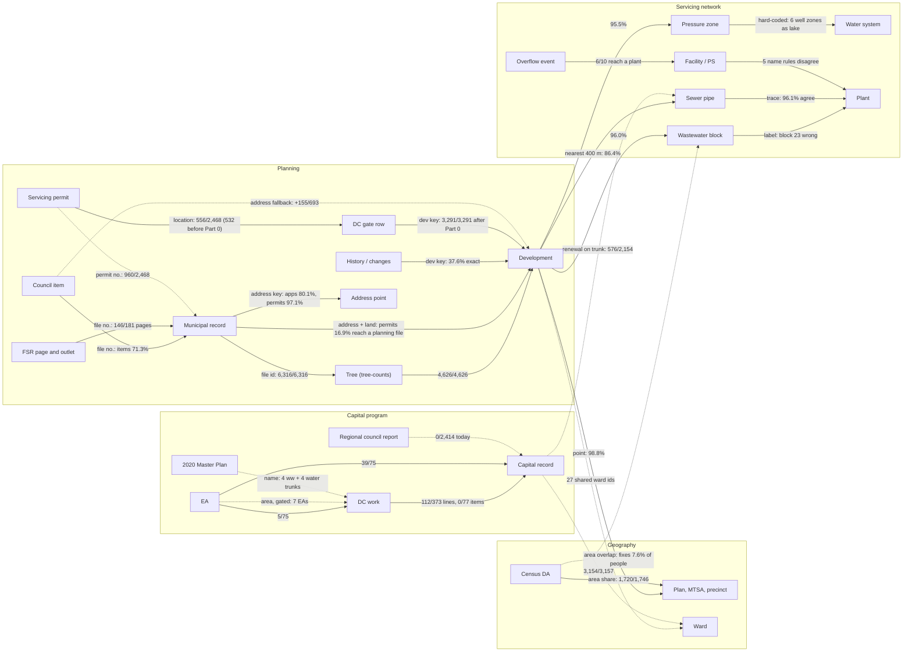

# Architecture review: the data, how it relates, and how the app is organized

Reviewed on `main` at `3b3ade0` (2026-10-24). Report only, except Part 0, which lists the fixes made
on branch `claude/ecstatic-johnson-4csfzo` alongside it.

How it was done: 8 read-only mapping passes (data files, build pipeline, the development model, runtime
loading; Home and its pages, the full map's tabs and sub-tabs, one development across the app,
reference / settings / tools) and a completeness critic; 4 passes on how the datasets relate, each
re-measured by an independent verifier; skeptical verification of every fix before it was made; and three
independent navigation designs scored by a judge. Every count below was measured on the shipped data
(numerator / denominator), not estimated. Line numbers in Parts 1–2 are for `3b3ade0`; Part 3 and
its appendix cite `60cd0e3`, the branch head with the Part 0 fixes.

**The short version**

1. **The data architecture is "rebuild everything in every browser".** 29 files, 54.9 MB raw / 6.0 MB
   gzip, load before the user does anything, and the browser rebuilds all 24,764 developments from
   85,141 raw records on every visit (about 4 s of CPU in Node, more on a phone). Every data URL carries
   the code build, so each push to main (3–36 a day from 10-16 to 10-24, each one a deploy) makes every
   returning visitor download all of it again, though the data changes weekly. The three biggest
   levers: content-hash the data URLs, publish one developments table built in the weekly job, and
   load each file when its view first opens.
2. **A development has no stable identity**, and that is the root of most data problems. Its key is an
   address, a 4-decimal coordinate or `address~root file`, so regrouping changes keys: the tree grouping
   alone mints 1,212 `address~root` keys the address grouping never had (and 411 address keys vanish).
   So 1,180 of the 4,626 developments with planning files (25.5%) have no history of their own (their
   parent's is copied), `history.json` keeps every retired key (only 37.6% of its keys are current;
   27,330 of the rest are second-unit addresses now held aside), and side files built on an older
   grouping drift (the DC gate missed 231 developments, 29,139 units — fixed in Part 0).
3. **The datasets relate well where they share an id, and poorly where they join on spelling.** Files to
   trees 6,316 / 6,316, unit lookups 91 / 91, IDF to blocks 40 / 40; but council items reach a file
   71.3% of the time (Mississauga 42.2%), DC works reach a capital record for 112 / 373 lines and
   0 / 77 facility items, and five rules disagree on facility names. One canonical file id, a facility /
   plant registry and build-time link files fix most of it (Part 2).
4. **Navigation has been merged at the menu level, but the structure underneath is still doubled.**
   Every full-map sub-view now has a page twin, an Explore page stacks three navigation bars under the
   top-bar trail (up to 5 rows above the answer), This week shows on about 10 surfaces, Capital lists
   the same DC projects three times with two lateness models, and "which stages count" has five
   controls over three vocabularies. Part 3 says what to combine.
5. **Bugs found and fixed now** (Part 0). The most urgent one: the weekly data update will be held
   every Monday from 2026-10-26 unless this branch is merged before that day's 10:17 UTC run.

---

## Part 0. Fixed on this branch

Each fix was verified against the code and data first; each commit adds a test that fails without it.
Unit tests: 1,410 before, 1,434 after, all passing; eslint clean; the 23 browser click-paths
(`npm run browser`) pass.

| Commit | What was wrong | What changed |
|---|---|---|
| `96ab5cf` | **The weekly update would be held from 2026-10-26.** `build-snapshot.js` wrote `data/snapshot-index.json` on every run; `tests/sources.test.js` (added 10-21) fails on any data file without a receipt, and a failing test holds the update with no override. The app also requested that never-published file first on every visit (a 404 before the snapshot). `history.json` and `capital.json` were each fetched and parsed twice at start-up. | The index is written only with `--index`; the app asks for it only when `STARTUP_INDEX` is on (pinned to the weekly commit list). `PeelUtil.dataJSON`: one request and one parsed copy per shared file. The unpublished alerts feed is asked for once per load, not on every ☆ Watch. |
| `fff631d` | The guide "How a capital project gets built" was unreachable (its id `capital` is the Capital workspace's). Capital › DC timing showed the Projects "To check" list (157 items) titled "Region capital projects being built". The Scenario's "Criteria & references" reopened its own popover. Ten help strings pointed to removed places. | Guide id `capguide`, with a test that no guide id is a workspace id; lists picked by title; the link opens the criteria editor; strings fixed; Help lists all 12 workspaces; "Nine guides". |
| `e1479e2` | Four developments (1,388 units, including 21T-22002C, the README's own example) could not be opened by key: a land split's `#1` looked like a branch. Opening a file "on its own" rewrote its development's permit flags (168 of 254 tested; 11903 Airport Rd's permit count 17 → 3). "Latest" file lists sorted on a field no record has. The Development tab's sub-development cache survived rebuilds. | Exact key first; sub-developments merge copies of the records; newest submission first (`PeelPhases.newestFirst`); the cache follows `state.projects`. |
| `df22d29` | "Left to build" meant planned − completed on Growth but planned − permitted in the CSV, the memo, the list sort and a selection tile (51 of 626 build-out developments differ). "Committed" was defined as MECP D-5-1 in the Definitions card, README, How the app decides and the capacity guide, while the Overview, briefing and Scenario count the Peel rule. The persons-per-unit card said apartment 2.7 (the criteria: 3.1, or 2.7 above 475 persons/ha). | One meaning each, with `left_to_permit` as its own CSV column; both commitment rules named where they apply; the card text pinned to `DEFAULT_CRITERIA`. |
| `2421eb2` | `tree-counts.json` was rebuilt by hand on 10-23 without `dc-gate.json` (10-20): 231 in-scope developments (29,139 units) had no site servicing permit chip and no filter value. | Gate rebuilt (3,291 / 3,291); a site check fails a pull request whose gate misses a development. |
| `ebe6a17` | The count-once audit reported 31,944 files "missing from every project" (Brampton's second units, held aside on purpose), so its deploy step failed on every deploy (red, not blocking); Records › Data checks showed 34,125 and a false flag. | Held-aside files are counted as such; the integrity checks read 0. |
| `60cd0e3` | The Watch tab's hidden copies of This week were still rendered on every update; Records › Data checks drew its checks list twice; the servicing memo's "Planned works nearby" never printed and its site context read an id nothing renders; dead renderers (old aerial check, `#d-quality`, the old development header, `renderHome`); the site page had no ☆ Watch though This week's help said it did. | Removed or fixed; the memo prints its works and the three existing-mains lines; Watch on the site page. |

**Merge before Monday 2026-10-26 10:17 UTC** for the first fix to protect that week's update.

---

## Part 1. Data architecture

### 1.1 What there is

| Area | Files | Size |
|---|---:|---:|
| `data/*.json`, `data/*.csv` | 50 | 69.3 MB (9.2 MB gzip) |
| `data/constraints/` tiles | 2,665 | 21.9 MB (`reg-cvc` alone is 9.6 MB, 49.5% of the tile bytes) |
| `data/3d/` PMTiles | 3 | 21.5 MB (range reads, never cached) |
| `data/probe/` reports | 4 | 0.29 MB (never fetched) |
| `scripts/` | 87 files, 18 run by no workflow or npm script | |
| `js/` | 154 modules, 3.74 MB (1.18 MB gzip), one 114-module dependency cycle | |
| `docs/` | about 1,500 screenshots, 206 MB, none referenced | |

91.7% of `snapshot.json`'s 85,141 records (42.3 MB) are building permits (88% of its bytes); Brampton's permits alone are
26.4 MB, and its 31,944 basement second units are about 15.6 MB, though they are used only as one-permit
servicing sites. Permit-only developments are 81% of developments (20,138 of 24,764) but hold 9% of the
units; the 4,626 with a planning application hold 254,594 units.

### 1.2 What to change, in order

**A. Version data by content, not by build** (M, medium risk). `js/util.js:15-24` tags every data URL
with the code build and `sw.js` deletes the data cache on every deploy, so 3–36 pushes to main a day each re-download
about 6 MB gzip per returning visitor against weekly data. `scripts/build-sources-index.js` already hashes
every file at deploy: emit a name → hash map, version each URL by its own hash, keep one data cache, drop
`cache: 'no-cache'` for hashed URLs. Keep a data-schema version check, because `util.js:10-14` documents
why the build tag exists (old data read by new code gave different totals).

**B. Publish one developments table, built in the weekly job** (L, medium–high risk). The development is
the entity every tab shows, yet it is never stored: each browser groups 85,141 records into 24,764
developments, regroups them into trees, then tags plans, zones and plants. `scripts/app-devs.js` already
builds the same grouping and counts in Node; the plan, zone and plant tags would be added to it. Write `data/developments.json` after Tree counts: a six-field row per development
(key, title, municipality, phase, point, units) is about 3.0 MB / 444 KB gzip; with the fields the list
and filters read it measured about 6.2 MB / 0.78 MB gzip (search text and descriptions left to the
snapshot). Add a record → development map, paint
from it, and load `snapshot.json` only for a development's detail, exports and audits. This replaces the
unpublished `snapshot-index.json` and the hot parts of `tree-counts.json` and `dc-gate.json`. It depends
on one decision (Part 4): whether to keep *Refresh live / Add source / Records since*, which need the
browser build.

**C. Load each file when its view first opens** (M, medium). Only the snapshot, tree counts, council
decisions, areas and servicing need to be eager for Home, plus small summaries for its "DC projects
late" (today computed from `sewers.json` and `dc-infra.json`), "Plans furthest behind" (`plan-targets.json`)
and the committed counts (the `dc-gate.json` buckets). `history.json` (accuracy report, time-lapse),
`capital.json` / `eas.json` (Capital), `dc-gate.json` (its filter and chip; only a few columns are hot),
`sewers.json`, master plans, plant flows, events and compliance (Servicing) can wait. About 716 KB raw /
231 KB gzip of labs, tools, exports, help text, the tour and the ledger code can load on demand too
(`PeelLazy.need(group)`), once there is a module manifest that index.html, `sw.js`, eslint and the tests
all read (today `sw.js` copies index.html's 154 scripts by hand, and 26 test files police the copy).

**D. Slim the snapshot** (M, medium). About 6.2 MB is constant or repeated (`newBuild` is true on all
85,141 records; municipality and kind follow from `sourceId`, and `uid` repeats it as a prefix). A v2 encoding with dictionaries and
short keys cuts the parsed size from 42.1 to 23.0 MB (gzip 4.04 → 3.72 MB). Before dropping `newBuild`,
flip the decoders' `false` default (`app.js:707`, `build-snapshot.js:62`), or every development hides.
Second units (about 15.6 MB) and pre-2021 completed permits (10.2 MB), about 22 MB together since they
partly overlap, can move to a cold file.

**E. Stop publishing what the app never reads** (S, low). 3.71 MB ships and is never fetched:
`tree-audit.json`, `capital-links-audit.json`, `servicing-permits.json`, `site-audit.json`, `probe/`,
`eas-overrides.json`, `unit-lookups.json`, `eas-review.csv`, `ww-facilities.json`, `tree-overrides.json`,
`capital-overrides.json`. Decide which are public receipts (Part 4); move the rest to `inputs/` and
`reports/` outside the published folder. Also drop the legacy census copy in `areas.json` (194 KB) and
`servicing.json`'s superseded drainage areas (147 KB, 55% of the file), after `build-alerts.js` and
`build-svc-census.js` move to blocks (`build-ledger.js` already uses them); only the browser's fallback
for a missing `censuses` reads the legacy census copy.

**F. One dataset manifest that drives the build** (M, low). `data/sources.json` is already a manifest
(script, refresh, from) but incomplete. Add `job`, `inputs`, `consumers`, `publish` and
`staleWhenNewer`, and generate the weekly `git add` list, the publish exclusions and the README data table
from it. `staleWhenNewer` would have caught the DC gate drift in Part 0 at build time.

**G. Group the files by role** (L, medium; after A–C, so each move is a one-line path change):

```
data/  developments/ (snapshot, developments, history, tree-counts, council*, fsr, address-points, servicing-gate)
       areas/ (areas, das-2021, das-2016, munis, plan-targets)
       servicing/ (servicing incl. blocks, svc-census, sewers*, watermains, water-*, plant-flows, ww-events,
                   compliance, idf, peel-reports, master-plan-*)
       capital/ (capital, eas, dc-infra, dc-costs, dc-joins)    housing.json (merged with peel-housing)
       reviews/ (dev-outlets, fsr-outlets)   meta/ (sources, changelog, refresh, versions)   constraints/  3d/
inputs/   (hand-curated: overrides, unit lookups, and the reference JSON now in scripts/)
reports/  (audits, review CSVs, probes — not published)
```

Rename `dc-gate` to `servicing-gate` (it is about site servicing permits, not DC capital) and `das.json` to
`das-2021.json`. In `scripts/`: a shared `scripts/lib/` (24 hand-written fetch/retry helpers; 6
point-in-ring and 6 simplify copies, with 4 and 2 more in `js/`; 6 copies of the Peel bbox); archive about 15 discovery probes; split
`probe-sources.yml`'s 40 modes by purpose. In the repo: move the 206 MB of screenshots to a release or an
orphan branch, and split the 223 KB README into a short README plus `docs/guide/`, `docs/method/`,
`docs/data/`.

**H. Outputs the app reads that nothing builds.** `data/alerts.json` / `.rss` (the This week capacity
alerts and the Watch alerts panel) and `data/ledger/` (the frozen ledger) have tested builders in
`scripts/` that no workflow runs, so those panels never show. Wire them in or remove the UI (Part 4).

### 1.3 How the development applications are organized

The model, step by step: raw ArcGIS feature → `normalizeRecord` (`js/phases.js`) → 85,141 records →
`dedupeRecords` (14,835 copies merged, 3.1 MB, on every load) → 70,306 records → `buildProjects` (grouped
by address and land; second units held aside) → `PeelTreeGroups.regroup` into the build-time trees
(`tree-counts.json`: 4,626 developments with planning files) plus 20,138 permit-only developments →
`mergeProject` (a 42-field object) → tree counts overwrite units and build-out → plan, zone and plant tags.

What makes it hard to keep right:

| Problem | Evidence | Fix |
|---|---|---|
| Three generations of grouping still live | The *Previous* counting mode is still reachable (Scenario); most Node tools (history and weekly changes, the startup index, alerts) still use the pre-tree grouping | Retire *Previous* (approved "for one release" on 10-15); route every Node tool through `scripts/app-devs.js` |
| Keys are derived, not stable | `Muni|ADDRESS`, `Muni|@lat,lng`, `Muni|ADDRESS~root`; 1,180 of 4,626 file developments have no history of their own; 59 of 500 "new this week" keys still exist | Sticky ids: `DEV-<MUN>-<root file id>` for developments with planning files, `SITE-<MUN>-<address point id>` for permit-only ones, inherited week to week by file majority; old keys become aliases |
| Derived figures computed in many places | 7 stage vocabularies in the code (three of them reach the controls), 3 file classifiers, 4 land-overlap samplers; completed, left to build, stage and committed each have several implementations; `devtab.js` is about 28% drifted copies of functions other modules export | One pure `dev-facts.js` (`factsOf(p, {basis, commit, asOf})`) that every page reads; delete the copies |
| A development's files have three views and two tree renderers | Overview › Files & history, Records › Files, Explore › site › Files | One Files view (Part 3) |
| Rules run on the browser clock | Dormant and stalled use `Date.now()` (and the lapse rule falls back to it when a caller passes no data date), so counts drift between weekly updates | Use the data date |
| Two plan / MTSA placements | 52 developments (3,966 units) fall in a different plan, and 93 in a different MTSA, depending on the screen | One placement (`plan-tables.js areaIdsOf`) for filters and the ledger |

---

## Part 2. How the data can relate to each other

Full detail, with every measurement and the build design: [`architecture-review/data-relationships.md`](architecture-review/data-relationships.md).

How capital projects, DC works and the existing network connect, and how to find the developments each
one affects now and as new applications arrive (a network trace, not a radius: the 400 m buffer misses
97% of the wastewater dependencies and 62% of what it reports is not on the development's path):
[`architecture-review/infrastructure-dependencies.md`](architecture-review/infrastructure-dependencies.md).

### 2.1 The entities and the id each should carry

| Entity | Canonical id (existing or proposed) | Where it lives |
|---|---|---|
| Planning file | `MIS-SP-2022-0060`, `BRA-LOT-C05W06-0007`, `CAL-RZ-2022-0006` (today `Muni|fileId`, spelled five ways) | snapshot records; tree-counts files |
| Building / servicing permit | `MIS-P-2025-006388`, `CAL-P-2024-001098.RV01` (revision as a part, not a new number) | snapshot; servicing-permits |
| Development | `DEV-<MUN>-<root file id>`, or `SITE-<MUN>-<ROPADRID>` for permit-only | new `dev-ids.json`; history, dc-gate, ledger, watch lists key on it |
| Council item / decision | `rpt:<muni>:<uuid>:<n>`; decisions keyed by file id | council.json, council-decisions.json |
| Regional council report | `rpt:peel:<eScribe id>` | none today |
| Plan area, MTSA, precinct | frozen source id beside today's name slug | areas.json, plan-targets, tree-counts |
| Census DA | `dauid` on every row (today rows are matched by array position) | das, areas.census, svc-census |
| Pressure zone, water system | `pz:<zone>`, `wsys:<slug>` through one table | servicing.json (system hard-coded twice) |
| Block, plant | `blk:<id>`; `plant:<key>` with MECP number and aliases | blocks, plant-flows, compliance, master plans |
| Facility | `fac:<sys>:<kind>:<slug>` with GIS FacilityID / SCADA id | servicing, ww-facilities, water-facilities |
| Pipe | `pipe:ww:<SMH>-<SMH>`, `pipe:w:<WND>-<WND>` (today array indexes) | sewers*, watermains |
| DC work, DC project | `dc:<sys>:c<component>`, `dcp:2026:<project>` (today keyed by component; the 27 of 431 lines without one are keyed by position) | dc-infra, dc-costs |
| Capital record, contract | `capr:<id>`, `cap:<contract>` | capital.json |
| EA | `ea:<slug>` with aliases | eas.json |

### 2.2 How they connect today

Solid lines exist today, labelled with method and verified match; dashed lines are links that could be
built, with the match measured on today's data.



### 2.3 What blocks linking

| Problem | Effect | Fix |
|---|---|---|
| No stable development id | the tree grouping made 1,212 new keys (1,148 splits) and dropped 411; history 37.6% current; side files drift | Sticky DEV / SITE ids with aliases (Part 1.3) |
| Side files built from an older grouping | dc-gate (10-20) was older than the trees (10-23), rebuilt in Part 0; history from the pre-tree grouping; capital.json (10-19) vs dc-infra (10-22), 12 stale positional keys | One link step after Tree counts in `site.yml`; every link file records its inputs' dates and the review gate fails when an input is newer |
| File numbers spelled five ways | `canonRef` glues tokens; the council regex misses concession-lot, 43M, `21T-M 24-5`, `H-OZ 19005`; Caledon numbers typed four ways (15 council keys land on two file types); permit revisions never meet their house permit | One shared `js/file-id.js` used by the council, FSR and tree builds, the override files, the DC gate and the browser |
| Array positions or source row numbers used as ids | DC works without a component, sewer and watermain nodes, census rows, water facilities, tree area tags (by position); record uids (the layer's OBJECTID) | Real ids (component, manhole, WND, `dauid`, FacilityID) kept through the builds |
| Facility and plant names joined by five normalizers | The Inglewood DC well maps to 1 record by one rule and 3 by another; plant aliases hard-coded (`masterplan.js:347`) | `xwalk-facilities.json` and `xwalk-plants.json`: one row per physical facility with every name, GIS id and kind |
| Point-in-polygon ignores holes (`phases.js:696`) | 30 developments get the wrong DA, 12 pz:7 sites are tagged pz:6, 32 fall in a catchment's hole | A hole rule per layer: even-odd for DAs, zones, catchments and blocks; keep any-ring for plans (their roll-up relies on it) |
| Wrong labels in the geography | Block 23 is labelled Lakeview while 546 of its 557 pipes drain to Toronto; 6 Caledon well zones (807 developments) are counted on the lake system | Choose a block's plant by its pipes; one zone → system table (needs Region confirmation for blocks 13 / 14 and zone 8A) |
| Empty review channels | `capital-overrides.json` and `dev-outlets.json` have 0 rows; browser edits stay in localStorage | Crosswalks with method, confidence and reviewed columns that the review screens export into |

### 2.4 Links worth building, ranked

The 18 of the appendix's 22 worth building now, in its order (#18 here is its #21).

| # | Link | Verified today | What you would see | Effort |
|---:|---|---|---|---|
| 1 | Side files and history for today's developments | DC gate done in Part 0. History 3,446 / 4,626 file developments; weekly changes 355 / 1,000 resolve | *Stalled 2+ years* and This week cover tree-split developments | S |
| 2 | DC ↔ capital status into the DC chip, taken from each work's own same-system records | 4 "Paused" lines show "under construction" or "tendered" through their contract, but 3 of them take it from a watermain record on the same contract page (a cross-system roll-up); 1 is genuinely tendered. Of the 5 "In the 2026 budget" lines, 1 has the same artefact (infrastructure-dependencies.md §9.2) | Capital › DC timing, the DC works tooltip and the funding scenario show each work's own status | S |
| 3 | One file id, then the council index fixes | 498 / 1,088 council keys hit; the address fallback resolves 155 / 693 unresolved items (Mississauga 143 / 351) | Files & history shows the right council history; zoning and draft approvals move stages | M |
| 4 | Servicing permit → development by permit number | 960 / 2,468 share number and year with a development's permit (957 at the same address), against 556 by location (532 before the Part 0 rebuild) | The site's servicing permit listed without a 60 m guess | S |
| 5 | Census DA × block by area, keyed by `dauid` | Centre points put 7.64% of people (110,832) in another block (block 22 +104%, block 10 −48%) | Servicing › Network catchment and Capacity census baselines become true overlap, as README already claims | S |
| 6 | Block plant labels | Block 23 → Toronto; 2,866 development points disagree with the traced network | *Receiving plant* filter and plant loads stop assigning Malton growth to G.E. Booth | S |
| 7 | One zone → water system table | 6 well zones counted lake-based (807 developments, 1,780 units) | Caledon village growth charged to its well systems | M |
| 8 | A precomputed development link table (zone, block, plant, plan, MTSA, precinct, DA, ward, nearest trunk, DC main) | Zone 95.5% and block 96.0% (developments with units or floor area), plan 98.8% (file developments), trunk 86.4% (pipeline file developments); the geography columns without DA measured 156 KB gzip, the full table not measured | Faster start; one answer on every tab and export | M |
| 9 | Build the alerts feed | Not built today | This week's capacity alerts and Watch alerts appear | S |
| 10 | EA → DC mains | By area (same system, geometry confidence medium or better): 7 EAs / 72 pairs; by name: 3 of 22 pipe EAs with a stop-list | Capital › EAs says which DC main an EA leads to; DC projects show the EA they wait on | M |
| 11 | Facility and plant registry | Events reaching a plant 6 / 10 today, 10 / 10 through station → block → plant (1 of them inherits block 23's wrong plant until #6) | Every overflow event and planned reservoir on its plant or zone | M |
| 12 | Area × area tables (precinct census shares, MTSA × plan, null MTSA split) | Precinct shares 0 / 30; 37 of 75 MTSAs span plans; an unnamed MTSA holds 241 developments | Growth › Areas gets precinct baselines and MTSAs within their plan | S |
| 13 | Ward ids | 27 shared ids; developments 11,198 / 24,764 carry one; imputation tested at 95–99% | A ward filter, ward roll-ups beside capital works and council items | S |
| 14 | 2020 DC projects → capital records | 22 / 137 project numbers appear in capital.json; the 14 that are not 2026 DC projects cover 57 records in 17 contracts (35 under construction), 2 of them linked today | Active construction marked as 2020-DC-funded | S |
| 15 | Related applications across developments | 11 cross-development mentions never shown; 1,515 overlap pairs | A "Related applications" list with the reason | S |
| 16 | Constraints on the site boundary, not its centre point | 345 / 2,411 sites flagged by point; 772 by the cells inside the boundary | Check a site flags land that touches regulated or flood areas | S |
| 17 | The receiving pipe and the whole servicing path, with stable pipe ids | A full path on the existing network for 16,937 / 20,990 developments (80.7%); 1,733 receiving pipes shared by 2+ developments (infrastructure-dependencies.md) | Servicing › Network shows who shares a pipe; a development lists the projects on its own path, and a project the developments upstream of it | L |
| 18 | Regional council reports | 0 / 2,414 municipal items mention an EA, plant or station | Which report funded or paused each DC project | L |

### 2.5 Where the links should live

A build step (`scripts/build-links.js`, run after Tree counts and again after capital and EAs) writes
link files the browser reads instead of recomputing them; each carries `generatedAt` and its inputs' dates.

| File | Holds | Replaces |
|---|---|---|
| `dev-ids.json` | sticky development ids, aliases, root file, files, permits, address point | key lookups in `dc-gate.js`, `tree-groups.js`, `phases.js` |
| `file-links.json` | per file id: aliases, development, council items (by file / address / crosswalk), decision, FSRs, servicing permits, mentions; stub files for council items whose file the feed dropped | `councilItems` (two copies), council decisions, `fsrFor` (two copies), earlier files |
| `dev-links.json` | per development: plan, MTSA, precinct, zone and block (each with the reason and metres), plant, DA, PS, ward, nearest trunk and mains, a constraint bitmask | `plan-areas.js`, `plan-tables.js`, `svc-data.js` tagging, `dc-infra.js` placement, `map-census.js` |
| `area-links.json` | precinct census shares, block × municipality, MTSA × plan, precinct × plan, served-weighted plan × block / zone, zone → system | `areas.js`, `masterplan.js:244/401`, `water-trace.js:194` |
| `infra-links.json` | DC works → project, capital records (method, confidence, status), EAs, pipes relieved, 2020 cost | `capital-ea-model.js dcCapitalIndex`, `capitalStatus`, `dc-relief.js` |
| `xwalk-*.json` | hand-reviewed crosswalks: facilities, plants, DC ↔ capital (supersedes the empty overrides file), 21T ↔ 43M plan numbers, MP 2020 | the five facility normalizers, `BOD_PLANT` |

Two shared modules sit under them, used by Node and the browser like `js/phases.js`: `js/file-id.js`
and `js/link-placer.js` (one development → zone / block / plant placer, with the hole rule per layer).

Order: (1) stop the drift — the capital system check and component keys, census on blocks, block 23's
plant (the weekly job already runs the gate after Tree counts; Part 0 rebuilt it after the 10-23 hand
rebuild and added a pull-request check); the alerts feed waits for development ids (Part 4 #4); (2) `file-id.js`
and `file-links.json`; (3) `dev-ids.json`; (4) `link-placer.js` and `dev-links.json`;
(5) `area-links.json`; (6) stable pipe and facility ids and `infra-links.json`; (7) the hand crosswalks
and new sources (Regional council, ward polygons).

---

## Part 3. Home, the tabs, and the tabs within the tabs

Full design, with the 201-row move table, the scope × tab matrix, the link-compatibility plan and the
phases: [`architecture-review/navigation-design.md`](architecture-review/navigation-design.md).

### 3.1 What is there now

- **Home** is a hub of 9 sidebar entries: Home and This week, then Explore, Servicing capacity, What's
  coming, Capital, Review outlets and Old pipes under 4 team headings, and Reference under its own (plus
  Labs when on), then Full map and a Start-screen select. Behind them sit 28 page ids and 13 panel-only sections: about 41 screens.
- **The full map** has 2 left-panel tabs (Find, Watch), 5 analysis tabs (Overview, Growth, Servicing,
  Capital, Records) with 15 sub-views and 24 detail panes, and 3 development sub-tabs (About / Files &
  history / Site).
- **Earlier rounds merged the menus but kept the structure doubled underneath.** Every full-map sub-view
  but Growth › Ledger renders twice (a panel spec, and hidden DOM shown only by "Open full table"), and
  every one has a page twin. An
  Explore page stacks the top-bar trail, a 5-view bar, an explore bar and a section bar, and the views bar
  repeats section-bar entries. Up to 5 navigation rows sit above the answer (6 on a phone).
- **Some content repeats or splits:**
  - one development appears on 28 surfaces;
  - This week appears on about 10;
  - Capital lists the same DC projects three times with two lateness models;
  - "which stages count" has five controls over three vocabularies;
  - checks have four homes;
  - the Water / Wastewater switch appears three times with three option orders;
  - fire flow, supply route, related applications and "DCs it would pay" exist only in full-map tables.

### 3.2 The rule

**A scope has five tabs — Overview · Growth · Servicing · Capital · Records — and a page and the full
map are two hosts of the same scope**, with the same tab strip and the same chips. That keeps SPEC §0
(the same five tabs at every scope, one destination for clicks). The page section bars, the Explore views
bar, the second and third trails and the 12 workspace chips go.

Three independent designs were scored by a judge out of 60: **spec-faithful 44**, scope-first 42 and
task-first 42. The recommendation is spec-faithful as the base. From task-first it takes search routing,
the click savings and the low-risk first steps. From scope-first it takes the link-compatibility layer,
Old pipes and FSR review as views, and DC projects as scopes.

### 3.3 What combines

| Now | Proposed | Why |
|---|---|---|
| Home sidebar: 9 entries under team headings | **Home · This week · Find · Help · Full map**, then *For your role* (up to 3 deep links per role, from one role list) and Labs | The headings were roles; shortcuts keep their one-click paths without nine entries |
| Explore's 5 views (Growth in an area, Check a site, Review an FSR, Forecast, Study area) | **Find**: one search on every page, routed by what it finds: a development → its page; a file number → its Records; a plan → its area; a facility or DC project → its scope; plus *Draw an area* | One search replaces a views bar and four entry points |
| Page section bars (Summary, Files, DC timing…) | The same five-tab strip and chips as the map | One name per thing; the page and map read alike |
| Growth: Pipeline · Areas · Forecast · **Ledger** | Pipeline · Areas · **Forecast** (with a "By period" block, which was the Ledger) | The Ledger is built on the Forecast's own model |
| Servicing: Capacity · Network · **Allocations** · **Model checks** | Area: **Capacity · Network · Old pipes**. Development: **Network · FSR review** | Allocations is the Capacity table plus one column (now a fold); Model checks are data checks (to Records); Old pipes leaves the sidebar; FSR review gets one host |
| Capital: DC timing · DC projects · Projects · EAs, plus the "DC timing" tool result and the EA-to-construction page | **DC projects** (one list, both verdicts: in service before capacity runs out; first homes before it is built) · **EAs** (with EA to construction) · **Construction** | Same projects listed three times; two models become two columns |
| Records: Sources · Data checks · Files, plus Reference's copies and a hidden gear page | Area: **Sources · Checks** (one home for all checks). Development: Records, one view (files and history, no chips). A file: its record | Four homes of checks → one |
| A development: 3 map sub-tabs, 6 page sections, a hidden verdict card, a site bar that CSS mostly hides | **One layout, page and map**: a header (stage, aerial and servicing-permit chips, ☆ Watch, Trace / Check FSR, memo, Inquiry draft) and the five tabs: Overview carries the sewer path line, plant reserve and the DC projects it relies on | Nothing about a development stays full-table-only |
| Reference: 6 sections (Help is one; the top-bar Help button opens it) + 9 guides: two names for one place | **Help**: Start here · How it works · Glossary (absorbs the Definitions card) · How the app decides | Data sources and checks are Records panels already |
| Settings in 8+ places | ⚙ opens one sheet: Display · Start screen · Reports · Labs · Usage | Two stub sections only pointed elsewhere |
| In-panel controls | One *System* control (Both · Wastewater · Water) and one sort vocabulary | Today three System option orders and three sort vocabularies |
| Left panel: Find · Watch | Kept. Watch shows the watch list and the top 5 of the one This week list | SPEC §4; no Data tab (already folded into Records) |

Results: area sub-view chips 14 → 11 (never more than 4 per tab), development sub-tabs 3 → 0, homes of
checks 4 → 1, DC project lists 3 → 1, navigation rows above the answer 5 → 3 (6 → 3 on a phone).

### 3.4 Clicks for the design audit's ten tasks

Counted from Home at 1440×900, one tap = 1, typing free (the same rule for every design).

| # | Task | Today | Proposed |
|---:|---|---:|---:|
| 1 | Servicing check for a development (zone, sewer path, plant reserve, DC) | 3 | 1 |
| 2 | Which zone reaches its limit first | 2 | 0 |
| 3 | What changed this week (full list) | 1 | 1 |
| 4 | Area report for a secondary plan | 4 | 2 |
| 5 | A file number and its tree | 3 | 1 |
| 6 | Most loaded zone / station and the developments driving it | 3 | 2 |
| 7 | Growth by horizon year for a drawn area | 5 | 4 |
| 8 | Developments relying on a DC project | 3 | 1 |
| 9 | Servicing statement for a pre-consultation | 4 | 2 |
| 10 | DC study inputs export | 2 | 2 |
| | **Total** | **30** | **16** |

Three paths get longer without a role shortcut (Old pipes and What's coming 1 → 2, Review outlets
1 → 3); the role shortcuts, and for Review outlets a site's path, bring them back to 1.

### 3.5 Phases (each ships on its own)

| # | Phase | Effort | Risk |
|---:|---|---|---|
| 0 | Alias and link layer, no visible change: every old page id, chip, tab key and share parameter keeps resolving (and the silent drop of moved `svs`/`rs` values at `share.js:134-135` is fixed) | S | Low |
| 1 | Find from every page with routed results; the Inquiry draft keeps the development open; the site Overview gets the path line; Home gets "first zone limit" | M | Medium |
| 2 | Servicing and Records merges (checks to Records, Allocations to a fold, one System control) | M | Medium |
| 3 | Ledger into Forecast | S–M | Low–medium |
| 4 | Capital 4 views → 3 (one DC projects list, both verdicts) | M–L | Medium–high |
| 5 | One development layout (after retiring *Previous* mode) | L | Medium–high |
| 6 | Pages render the five-tab strip; one trail; the 12 chips go | L | High |
| 7 | Home sidebar 9 → 5, Help, one Settings sheet (after usage evidence) | M | Medium |
| 8 | Every scope kind gets real tabs (servicing scopes, a file, a DC project, an EA) | L | Medium |
| 9 | Words sweep: README sections, tour, info cards, "What moved where" | S–M | Low |

Watch for these in every phase: the Excel workbook reads hidden pane bodies by id (`exports.js:260-261`)
and the servicing memo reads the site's existing-mains and fire-flow boxes (`reports.js:274`), so every
phase keeps those ids, changes only `data-sub` / `data-pane`, and renders a pane before exporting from a
page; 1,943 regex assertions in 178 test files pin text (443 of them directly on source); `tips.js` MOVED
needs a row for every move.

---

## Part 4. Decisions for you

The recommendation is first in each row.

| # | Question | Recommendation |
|---:|---|---|
| 1 | Keep *Refresh live*, *Add source*, *Discover datasets*, *Records since*, *Max per layer*? | Keep them for now under Records › Sources › Advanced. If they go, the in-browser build can go too and Part 1.2 B gets simpler; that is the biggest single simplification available. |
| 2 | The startup index: delete it, or rebuild it on the trees and publish it? | Delete it (and `bootFromIndex`, `snapshot-index.js`, `buildIndex`), and replace it with the developments table (Part 1.2 B). Today it is gated off. |
| 3 | Retire the *Previous* counting mode now? (approved 2026-10-15 "for one release") | Yes, before the development-layout work; it threads a second model through every figure. |
| 4 | The weekly alerts feed and the frozen ledger (`build-alerts.js`, `build-ledger.js`): wire them in or remove the panels? | Hide the alerts UI now (wave 1); wire `build-alerts.js` in once development ids are stable (wave 3; as written it would key alerts by the *Previous* grouping). Keep the Forecast's "Since the last snapshot" fold and run `build-ledger.js` on its annual procedure. |
| 5 | Which reports are public receipts? (`tree-audit`, `site-audit`, `capital-links-audit`, `eas-review.csv`, `probe/`) | Publish the few the Sources page links as receipts; move the rest out of the published folder. |
| 6 | Permit-only developments (81% of developments, 9% of units) and Brampton's 31,944 second units: full records in the snapshot, or compact servicing tables? | Compact tables; the second units alone are about 15.6 MB of the 42 MB snapshot. |
| 7 | Is SPEC §0 still binding (five tabs at every scope), with §4's Data tab superseded by Records? | Yes, as stated. Part 3 depends on it. |
| 8 | One DC projects list with both verdicts? | Yes. |
| 9 | Ledger stage cut-off: keep it inside Forecast › By period, or let the Scenario's Count drive it? | Keep it in the merge, then drop it, so the Scenario's Count is the one control for which layers count (Find › Stage, Counts as and Scenario › Units stay). Dropping it loses the "+ Plan approved" cut, which the Count does not have. |
| 10 | Team headings → *For your role* shortcuts (adding QA/QC as a role)? | Yes, after asking pilot users for their Settings › Usage exports. |
| 11 | Should drilling into a plan set the plan filter for the map and every tab? | Yes (one "where"); users will notice the change. |
| 12 | Growth's *By dwelling type* "Left" column is planned − permitted beside a planned − completed total: relabel it "To permit", or recompute it as left to build? | Relabel now (no number changes); recompute later with the derived-figures module. |
| 13 | Capital contract and EA page changes this week have no visible renderer since the This week page took over: list them there? | Yes, when they first appear (both files have none today). |
| 14 | The deploy's count-once audit reads 0 now: make it blocking? | Yes. |
| 15 | Region confirmation needed: which plant blocks 13 and 14 drain to, and whether zone 8A is partly lake-fed | Ask. Only blocks 13 / 14 (Part 2.4 #6) and zone 8A (#7) wait on it; block 23's plant (546 of 557 pipes drain to Toronto) and the other well zones can be fixed now. |

[navigation-design.md](architecture-review/navigation-design.md) §9 numbers these differently: its 1 = #7,
2 = #9, 3 = #8, 6 and 12 = #10, 7 = #1, 8 = #4, 10 = #11, 14 = #3; its 4, 5, 9, 11, 13 and 15–17 are
design-level and decided there.

---

## Part 5. Roadmap

| Wave | Data | Navigation |
|---|---|---|
| **Now** | Merge this branch (before Monday's update). | — |
| **1. Stop the drift** (days, low risk) | Dataset manifest with `staleWhenNewer` (1.2 F); the link step's first items: capital same-system check and component keys, census on blocks, block 23 (2.5 step 1); stop publishing reports (1.2 E); retire *Previous* (Part 4 #3); hide the alerts UI (Part 4 #4) | Phase 0 (aliases), phase 9's README fixes for what already moved |
| **2. Load less** (1–2 weeks) | Content-hashed data URLs (1.2 A); load each file when its view opens (1.2 C); a module manifest and lazy code groups | Phases 1–3 (Find everywhere, Servicing / Records merges, Ledger into Forecast) |
| **3. One model** (2–4 weeks) | Developments table from the weekly job (1.2 B); sticky ids (`dev-ids.json`); `js/file-id.js` and `file-links.json`; `dev-facts.js` for every derived figure; snapshot v2 (1.2 D); the alerts feed on the new ids | Phases 4–5 (Capital 4 → 3, one development layout) |
| **4. One system** (4+ weeks) | `link-placer.js` and `dev-links` / `area-links` / `infra-links`; the facility and plant registry; folders by role (1.2 G); `scripts/lib/`; README split; screenshots out of the repo | Phases 6–8 (pages render the tab strip, Home sidebar 9 → 5, every scope kind) |

Each wave keeps the README's "one set of numbers" rule, guarded by the browser paths
(`npm run browser`, 23 paths, all passing on this branch) and the unit suite.
