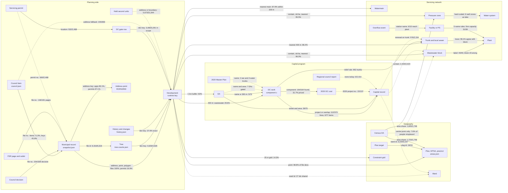

# Peel Growth Pipeline: how the datasets relate, and how to link them better

Synthesis of four domain surveys (existing joins, developments, infrastructure, geography) and an
adversarial re-measurement of every link. Repo `/home/user/Fsr-reviewer`, data as committed on
2026-10-24. Where a verifier changed or refuted a finder's number, the verifier's number is used.
Anything not re-measured is labelled **not measured** or **unverified**.

Part 2 of [the architecture review](../architecture-review.md), in full. The measurements were made with
throwaway Node scripts run against `data/` at `3b3ade0`; they are not in the repo (section 9).

Since then, `data/dc-gate.json` was rebuilt on the current trees (review Part 0, `2421eb2`): the
"231 in-scope developments with no gate row" below now reads 0 of 3,291.

---

## 0. The short version

- **Everything hangs off the development**, and the development has no stable identity. Its key is
  a normalised address, a 4-dp coordinate or `address~root file` (js/phases.js:750). One tree
  rebuild made 1,212 new keys and dropped 411. Only 37.6% of history.json keys are current keys,
  and 231 of 3,291 in-scope developments (29,139 units, including the 9,961-unit
  Brampton|111 MAYFIELD RD) have no DC-gate row because dc-gate.json was built three days before
  tree-counts.json.
- **Key-based joins are good where both sides use one id**: files to trees 6,316/6,316, unit
  lookups 91/91, IDF to blocks 40/40, DC components to 2020 costs 164/164 found.
- **Joins on file numbers lose links to spelling**: council items reach a file 71.3% of the time
  (Mississauga 42.2%), and only 45.8% of council file keys match. Some of the loss is fixable
  (glued tokens, untyped Caledon numbers, a narrow regex). Most of it is files the open-data feeds no
  longer carry.
- **The infrastructure side is the weakest**: DC works to capital 112/373 lines (30.0%) and 0/77
  facility items. EAs to DC 5/75. Facilities are joined by five different name normalisers. Pipes
  are array indexes.
- **Geography is high coverage but has label errors**: block 23 is labelled Lakeview while 546/557
  of its pipes drain to Toronto. Six Caledon well zones are charged to the lake system. Census
  people go to blocks by DA centre point and land in the wrong block 7.64% of the time.
- **Most joins are deterministic but recomputed in the browser** on every load (grouping ~4 s,
  area tagging ~0.73 s first pass). The precomputed first-paint index is written but never
  committed, so it never runs.

The biggest wins, in order: rebuild key-dependent side files from today's grouping and resolve keys
through aliases; feed the existing DC-capital links into the DC status chip; one canonical file-number
module for council, FSR, permits and overrides; join servicing permits by permit number; DA x block
census shares and the block 23 plant fix; then one build step (`scripts/build-links.js`) that writes
stable-id link files the browser reads instead of recomputing.

---

## 1. Core entities and canonical IDs

Deduplicated across the four surveys. "Proposed" ids are design, not data that exists today.

| # | Entity | Dataset(s) | Key today (example) | Count | Canonical ID (proposed unless marked existing) |
|---|---|---|---|---|---|
| 1 | Planning file | data/snapshot.json `records` kind=application | `Muni|fileId` via canonRef (js/phases.js:341-369), e.g. `Mississauga|21T|M|11006`; uid `mis-devapps/6:22` | 7,046 raw, 6,316 after dedupe | `<MUN>-<SERIES>-<YYYY>-<NNNN>[.PART]`, e.g. `MIS-SP-2022-0060`, `BRA-LOT-C05W06-0007`, `CAL-RZ-2022-0006`; ward/stage/revision as attributes |
| 2 | Building permit | snapshot.json `records` kind=permit | uid `<layer>:<OBJECTID>`; ref `BP 9NEW 25-6388 ARU` | 78,095 raw, 63,990 deduped; 31,944 Brampton second units held aside | `MIS-P-2025-006388`, `BRA-P-2026-099111(.P02)`, `CAL-P-2024-001098(.RV01)` |
| 3 | Development (and tree) | built at run time js/phases.js:912 (mirror scripts/app-devs.js); data/tree-counts.json `devs` | `Muni|ADDR`, `Muni|@lat,lng`, `Muni|ADDR~<root>` | 24,764 (4,626 with a planning file; 1,651 point keys) | `DEV-<MUN>-<root File ID>` / `SITE-<MUN>-<ROPADRID>` / `SITE-<MUN>-<geohash9>`, made sticky by `data/dev-ids.json` |
| 4 | Council meeting / item | data/council.json | `Muni:<uuid>` + item index; index key `Muni|canonRef` | 1,022 meetings, 2,414 items, 1,088 file keys | existing meeting id + item n (`rpt:<muni>:<uuid>:<n>`) |
| 5 | Council decision | data/council-decisions.json | `Muni|canonRef` | 1,088 keys, 328 with zoning or draft | File ID |
| 6 | Regional council report | none (scripts/build-council.js:26-30 builds 3 municipal portals only) | one hard-coded URL js/util.js:86 | 0 | `rpt:peel:<eScribe DocumentId>` |
| 7 | FSR page / FSR outlet | data/fsr.json, data/fsr-outlets.json | page url + `keys[]`; outlet url = fsr.url | 181 pages (Brampton 0), 66 FSR documents | File ID list + existing url |
| 8 | Servicing / septic permit | data/servicing-permits.json `rows` | `source|ref`, e.g. `mis-permits|DRAIN 26-3617` | 2,468 (1,192 site, 1,276 septic) | permit File ID (same as #2) |
| 9 | DC gate row | data/dc-gate.json `developments` | development key | 3,139 | DEV/SITE id |
| 10 | Address point | data/address-points.json | `Muni|num|NAME|TYPE|DIR` -> ROPADRID | 56,360 keys | existing ROPADRID (attribute, and SITE id) |
| 11 | Phase history / weekly changes / ledger / alerts | data/history.json, snapshot.json `changes`; data/ledger/ and data/alerts.json do not exist | development key | 62,684 history keys | DEV/SITE id |
| 12 | Manual override files | unit-lookups.json, tree-overrides.json, eas-overrides.json, dc-joins.json, capital-overrides.json, dev-outlets.json | `Muni|raw ref`; EA slug; end coordinates | 91; 1 + 47 roots; 60; 6; **0**; **0** | File ID / ea / dc / DEV ids |
| 13 | Municipality | data/munis.json | name | 3 | existing name |
| 14 | Ward | snapshot `records[].ward` ('11', 'WARD 4', 'Ward 3'); capital.json `ward` ('M05', 'C03,B10') | text | 27 normalised ids | `M01..M11`, `B01..B10`, `C01..C06` (the capital.json form) |
| 15 | Plan area: secondary plan / character area, MTSA, precinct | data/areas.json; hierarchy in tree-counts.json `areas[].parent` | slug of the name (scripts/build-areas.js:109), e.g. `sp:brampton:52:-heritage-heights` | 120 / 75 / 30 | existing slug, plus a frozen source id beside it |
| 16 | Plan target | data/plan-targets.json | area id | 15 targets, 19 ids | area source id |
| 17 | Census DA (2021, 2016) | data/das.json (dauid), areas.json `census.das` (by position), data/svc-census.json (by position), data/das-2016.json | dauid only in das.json | 1,746 / 1,650 | existing dauid on every row |
| 18 | Pressure zone | data/servicing.json `pressureZones` | `pz:<zone>` | 24 | existing `pz:` |
| 19 | Water system | hard-coded js/masterplan.js:244 and js/water-trace.js:194 | name | 1 lake + 4 well systems | `wsys:<slug>` in a zone table |
| 20 | Traced drainage area / PS catchment | servicing.json `drainageAreas` | `dr:SMH…`, `dr:FACSCADA-…` | 36 (19 PS) | existing ids |
| 21 | Wastewater block (and IDF block) | data/blocks.json, data/idf.json | id `1`..`40`, app id `dr:B<id>` | 40 | existing `blk:<id>` |
| 22 | Plant | servicing.json `plants`, plant-flows.json, compliance.json, peel-reports.json, master plan | short name (`Lakeview`); MECP number only in plant-flows | 3 + Toronto | `plant:<key>` with MECP number and every alias |
| 23 | Facility (WW pumping station, water plant/PS/reservoir/well) | servicing.json `pumpingStations` (name only), data/ww-facilities.json (`ww-<slug>`), data/water-facilities.json (positional `wfN`) | names | 39 GIS ww stations, 45 water records | `fac:<sys>:<kind>:<slug>` with GIS FacilityID / FACSCADA id |
| 24 | Sewer pipe (trunk, local), watermain edge | data/sewers.json, sewers-local.json, watermains.json | array index; FacilityID dropped | 14,056 / 42,424 / 26,085 edges | `pipe:ww:<SMHup>-<SMHdown>`, `pipe:w:<WNDa>-<WNDb>` |
| 25 | DC work (line, facility item) and DC project | data/dc-infra.json, scripts/dc-facilities.json | component `c`; positional `<sys>:line:<i>` when no component (scripts/capital-lib.js:311) | 431 lines (373 works), 35 facilities, 77 items | `dc:<sys>:c<component>` (else `dc:<sys>:x<hash of ends>`), `dcp:2026:<project>` |
| 26 | 2020 DC cost component / project | data/dc-costs.json | component number; 2020 project number | 164 / 137 | existing component; `dc2020:<proj>` |
| 27 | Capital record / contract | data/capital.json `records` | `id`, `contract`, `projectNumber`; componentId on 9/3,157 | 3,157 records, 434 contracts | `capr:<id>`, `cap:<contract>` |
| 28 | DC-capital link | capital.json `links`, capital-links-audit.json | (dc key, capital id) | 282 | (`dc:`, `capr:`) rows in `data/infra-links.json` |
| 29 | Environmental assessment | data/eas.json (+ eas-overrides.json, scripts/ea-trace.json, eas-review.csv) | slug | 75 | `ea:<slug>`, frozen, with `aliases[]` |
| 30 | 2020 Master Plan row | data/master-plan-wastewater.json, master-plan-water.json, peel-reports.json `masterPlan.sps` | MP ids (`W18.0`, `WW-TR-183`, `WT7`) | 34 ww trunks, 20 water trunks, 31 PS rows (twice) | `mp2020:<id>` |
| 31 | Overflow / spill event | data/ww-events.json | sacRef | 30 | existing sacRef |
| 32 | Constraint grid / tiles | data/constraints/ | 25 m cell; tile key | 13 datasets | existing |
| 33 | Housing aggregates | housing.json, peel-housing.json, peel-reports.json `forecast2051` | municipality x year | 3 municipalities | existing |
| 34 | OSM buildings / terrain | data/3d/*.pmtiles | tile | 196,225 buildings | none (map layer only) |

---

## 2. Relationship graph

Solid edges are joins the app makes today; dashed edges are links that are missing or only modelled.
Labels give the method and the verified match.



---

## 3. Existing joins and their verified quality

"Runs" says where the join is computed: **Build** (a script writes the result into data/),
**Browser/load** (recomputed on every load or rebuild), **Browser/open** (computed when a panel
opens), **Not run** (code exists, no workflow runs it).

### 3.1 Planning side

| # | Link | Method | Runs (file:line) | Verified match | Problems |
|---|---|---|---|---|---|
| J1 | Record -> development | normalised address + 4-dp point + polygon containment + multi-address + nearby permits | Browser/load js/phases.js:912 (projectKey :750, joinMultiAddress :1111, joinNearbyPermits :1145) from js/app.js:237; build mirror scripts/app-devs.js | Files 6,316/6,316 in a development. Permits in a development with a planning file 10,789/63,990 (16.9%); permits of 20+ units 99/125 (79.2%, 83.7% of their units). Post-2016 permits 17.7%, so age does not explain the low rate: most permits are 1-2 unit houses. Unmatched large: BP 3NEW 12 2695 4011 Brickstone Mews (591 u), 510 Curran Pl (419 u) | ~4 s per load; the key is an address and churns; two address normalisers |
| J2 | File / permit -> tree | exact id lookup of a build-time tree | Build scripts/build-tree-counts.js; Browser/load js/tree-groups.js:36, js/tree-counts.js | 6,316/6,316 files, 1,651/1,651 permit placements, all in the dev the tree names. Shipped tree has 2,714 links (176 low) | data/tree-audit.json is stale (10-14 live pull: 2,800 links, 260 low); do not quote it |
| J3 | File description -> other file named in it | regex REF_IN_TEXT + canonRef | Browser/open js/earlier-files.js:32; tree build js/tree.js:427 | 116/160 non-43M mentions resolve (72.5%): 105 same development, 11 another. 40 more are 43M plans | `implied()` (js/earlier-files.js:45) lists only mentions the data does not hold, so the 11 cross-development links are never shown |
| J4 | unit-lookups / tree-overrides -> file | manual, exact raw ref (Caledon typed) | Build js/tree.js:219 lookupOf | unit-lookups 91/91 (88 by raw ref, 3 by typed Caledon key); tree-overrides 1/1; reviewed roots 47/47 | A third key spelling (`Muni|raw ref`). (The geography survey's 88/91 counted raw refs only.) |
| J5 | history.json -> development | exact key + alias / tree-merged resolution | Browser/load js/tree-groups.js:82 resolveAll, :133 translateHistory, from js/app.js:629 | Exact 23,552/62,684 keys (37.6%), +939 through aliases; 27,330 of the rest are held second-unit addresses. File developments with history 3,446/4,626 (74.5%); the ~1,180-1,212 without are the tree's new keys | Written from the pre-tree, pre-council grouping (scripts/build-snapshot.js:128, :150), so every regroup restarts a development's clocks |
| J5b | snapshot.json `changes` -> development | same | Browser/load js/tree-groups.js (translateChanges) | 355/1,000 listed changes resolve (35.5%); the 645 others are small (1,367 units) | same cause as J5 |
| J6 | Council item -> planning file | FILE_RE (scripts/council-parse.js:9) + canonRef variants | Build index scripts/build-council.js; Browser/open js/dev-detail.js:341 and an identical copy js/devtab.js:409 | Items 1,721/2,414 (71.3%): Mississauga 256/607 (42.2%), Brampton 1,362/1,660 (82.0%), Caledon 103/147 (70.1%). Council keys 498/1,088 (45.8%). Files 458/6,316 (7.3%), master files (OPA/ZBA/subdivision) 410/699 (58.7%). File developments 412/4,626 (8.9%) but they hold 52.2% of units. Mississauga hit rate rises by year (2020 11/81 to 2026 57/62) | Two copies of the lookup. Joins on r.fileKey not the typed fileId, so 15 Caledon keys land on two file types and 28 Caledon records get only items naming another type. 8 glued keys (`OZS2020|2`). FILE_RE misses concession-lot numbers, 43M, single-digit 21T-M, 5-digit H-OZ. The Mississauga feed drops closed files |
| J7 | Council decision -> record (`r.council`) | canonRef + OZ/OPA variants | Browser/load js/council-decisions.js:67 applyTo (keysOf :60) from js/app.js:232 | Decisive keys 204/328 (62.2%); 458/6,316 records get r.council (181 zoning by-law, 36 draft); 175 developments. Read at js/phases.js:1334/:1346/:1777 to move phases | Same key problems as J6; 15 double-type Caledon keys carry only `last` dates |
| J8 | FSR page -> planning file | own normaliser scripts/build-fsr.js:56 | Build; Browser/open js/fsr.js:41 and a copy js/devtab.js:621 | Pages 146/181 (80.7%: Mississauga 57/75, Caledon 89/106, Brampton 0 pages). FSR documents 57/66. File developments with a page 133/4,626 (2.9%). Caledon developments with an FSR document 58/186 (31.2%, 69.5% of units) | Misses are files absent from the feed: re-keying with js/phases.js fileId recovers 0 pages. Two copies of fsrFor |
| J9 | FSR outlet -> FSR page -> file | exact url, then keys | Browser/open js/dev-outlets.js:132, :297 fsrOutletOf | URL 66/66; keys reach a file 57/66 (86.4%). Outlets name a street 42, pipe size 36, manhole 2, project 1 | Used only as a check beside the app's guessed outlet; data/dev-outlets.json has 0 outlets |
| J10 | Servicing permit -> development (DC gate) | site boundary, address, 60 m nearest, date order | Build scripts/build-dc-gate.js:138; Browser/load lookup js/dc-gate.js:91 rowOf (exact key) | Permit rows on a development 532/2,468 (21.6%; 526 distinct numbers): site 228/1,192, septic 304/1,276. Gate keys still current 3,118/3,139 (99.3%). Reverse: in-scope developments with a row 3,060/3,291 (93.0%); the 231 missing hold 29,139 units (12.9%), e.g. Brampton|111 MAYFIELD RD (9,961 u), Brampton|137 STEELES AVE W~OZS-2025-0019 (991 u) | dc-gate.json (10-20) predates tree-counts.json (10-23) and is looked up by exact key. Ignores the permit number (see O4) |
| J11 | Record address -> Region address point | address key, then loose key | Build scripts/build-addresses.js:55; Browser/open js/address-key.js:58 | Applications 3,706/4,627 (80.1%; 89.2% of those that produce a key). Permits 62,111/63,990 (97.1%). Developments 22,594/24,764 (91.2%). Matched point >250 m away 386/65,817 | A second address normaliser (vs js/phases.js:179); keys() does not split comma lists; the browser's loose fallback never hits (0 loose keys shipped). ROPADRID is not used as a key, and using it for grouping would join only 7 more permit-only developments |
| J12 | Development <-> development (same land) | boundary overlap, file mentions | Browser/open js/dev-nav.js:112 relatedProjects | 1,515 related pairs over 1,775 developments (1,997 boundary pairs overlap >=15%) | Recomputed per open; not stored |
| J13 | Permit-only development inside a planning-file boundary | spatial-contains with date order | Browser/load js/phases.js:912 | 498/20,138 sit inside a planning-file boundary but stay apart; 466 have the permit before the file (correct), 32 after (candidate missed joins) | No record of the decision |

### 3.2 Geography

| # | Link | Method | Runs | Verified match | Problems |
|---|---|---|---|---|---|
| J14 | Development -> municipality | source attribute | Build (snapshot) | 24,764/24,764; polygon disagrees for 4 (e.g. Brampton|7751 WINSTON CHURCHILL BLVD in Mississauga's polygon) | none (data check only) |
| J15 | Development -> secondary plan, MTSA (point) | point in polygon, own municipality | Browser/load js/plan-areas.js:36 from js/app.js:259 | All developments: plan exactly one 24,014, none 712, two 38 (all parent+child). MTSA one 1,498, two+ 268. File developments: plan 4,569/4,626 (98.8%), MTSA 995 (21.5%) | Duplicates J17. One MTSA is the unnamed record `mtsa:brampton:null-null-planned-` holding 241 developments |
| J16 | Development -> precinct (point) | point in polygon | Browser/load js/plan-tables.js:42-45 | 7,164 in one, 6 in two; file developments 396-401 | precinct has no census baseline (J21) |
| J17 | Tree boundary -> plan area shares | overlap share >= 0.05 | Build js/tree.js:817 tagAreas (tree-counts devs[].a); Browser js/plan-rollup.js | Trees tagged 4,261/4,626; same primary as the point test 4,247/4,255 (99.8%); 409 split across plans | Two plan joins with different rules |
| J18 | Plan target -> plan area | exact slug | Browser js/plan-rollup.js:147-177 | 19/19 ids; 19/120 plans have a target | Ids are slugs of names: a renamed plan silently loses its target |
| J19 | Precinct / nested plan -> parent plan | area share | Build scripts/build-tree-counts.js:43-60 | 35/35 parents resolve; 29/30 precincts have a parent; 25/30 lie >=95% in it | 40-3 has no parent (same size as 40 (d), skipped by `b.m2 <= a.m2` at :54); 44-1 is split 52.9/47.1 but has one parent |
| J20 | Census DA -> plan / MTSA | area share (24x24 samples) | Build scripts/build-areas.js:166-183 | 1,720/1,746 DAs carry shares; every plan and MTSA has one; precincts 0/30 | Plan + MTSA census approximated by min of the two shares (js/areas.js:79-88) |
| J21 | areas.json census rows <-> das.json outlines | array position | Build/Browser js/plan-areas.js:22-25 | 1,746/1,746 (2021) and 1,650/1,650 (2016) agree on population | No dauid on the rows |
| J22 | Census DA -> pressure zone | area share | Build scripts/build-svc-census.js (probe mode only) | Zone shares reproduce for 1,740/1,746 DAs; DAs with >=0.5 share in a zone 1,695 | Sample points assigned with PeelAreas.locate (:44), holes ignored: pz:7 gets 4.2% too few people |
| J23 | Census DA -> wastewater block | DA centre point x served | Browser/open js/svc-tab.js:62 (fallback because 0/36 svc-census drainage ids are blocks) | Centre vs area overlap moves 110,832/1,451,022 people (7.64%); block 22 +104%, block 10 -47.9%, block 15 -25.1% | README:643-646 says this is by area overlap; svc-census.json (10-09 01:03) predates blocks.json (10-09 20:33) |
| J24 | Development -> census DA | point in polygon, first hit | Browser/open js/map-census.js:128 | 24,710 in one, 53 in two (all DA holes), 1 none; the first hit is the wrong DA for 30 of the 53 (253 units) | Holes ignored (js/phases.js:696) |
| J25 | Development -> constraint grid | 25 m cell (area card); point vs tile polygons (checklist) | Browser/open js/constraint-geo.js:170 flagsAt via js/constraint-data.js:96; js/constraint-data.js:27 evaluateSite | Pipeline file developments flagged 345/2,411 (14.3%: regulation 306, flood 128, provincial plan 70) | Point only. Cells inside the boundary would flag 772; boundary vertices 892/2,322 (38.4%) |
| J26 | Plan -> municipality; address point -> municipality; grid -> municipality; housing -> municipality | attribute / name | Build | 118/120 plans >=95% inside their municipality; 56,306/56,360 address keys agree with the polygon; grid 24,760/24,764; housing names 3/3 | Housing has nothing finer than municipality (CMHC zones summed at scripts/build-housing.py:47-55) |

### 3.3 Servicing network

| # | Link | Method | Runs | Verified match | Problems |
|---|---|---|---|---|---|
| J27 | Development -> pressure zone | contain, then planned main within 1 km (dcVia), then nearest <= 5 km | Browser/load js/svc-data.js:118 tagAreas, js/dc-infra.js:97 dcVia | All 24,764: contained 23,602, two 12 (pz:6 hole; all get pz:6, even-odd says pz:7), dcVia 556, nearest 584, none 10. Developments with units or GFA: contained 20,052/20,990 (95.5%) | Recomputed every load; holes ignored |
| J28 | Development -> wastewater block -> plant | same, plus a low-served rule for block 40 | Browser/load js/svc-data.js:118, blocks mapped at :66-79 | All: mapped 23,710, two 5, dcVia 53, nearest 652, none 344 (all block 40, on septic). Units or GFA: 20,147/20,990 (96.0%). Block -> plant 40/40 | Block 23 labelled Lakeview while 546/557 of its own pipes drain to Toronto; blocks 13/14 trace 93%/89% to Clarkson; 2,866 development points get a different plant from the traced network |
| J29 | Development -> plant (alerts and ledger copies) | containment in traced areas only (alerts); blocks + nearest (ledger) | **Not run**: scripts/build-alerts.js:145, scripts/build-ledger.js:47 are in no workflow | Alerts' placer gives no plant to 641/2,745 live developments (23.4%, 71,212 units); agrees with the app on 1,932/2,104 (91.8%). Ledger rows built in memory: 376/430 find their dc-gate row | A third placer. data/alerts.json is absent, so js/alerts.js:110 gets a 404 |
| J30 | Development -> nearest trunk sewer | nearest >= 300 mm within 400 m; dev-outlets.json overrides | Browser/open js/sewer-cap.js:87 nearestPipe in sewerGrowth (:129); js/dev-outlets.js:157 | Pipeline file developments 2,083/2,411 (86.4%). Weighted by units it is weaker: live file developments with units 490/610 but 70.3% of units; largest misses Brampton|111 MAYFIELD RD (9,961 u), Caledon|14275 THE GORE RD (4,456 u). Pipe plant = block plant 2,015/2,080 | Array index; weakest on the big greenfield sites; dev-outlets.json empty |
| J31 | Sewer network (manhole/trunk/local -> plant), watermain graph | network trace | Build scripts/build-servicing.js, build-sewer-capacity.js, build-watermains.js | Trunks with a valid next 14,023/14,056; reach an outfall 14,054. Local -> trunk 42,299/42,424 (99.7%). Watermain largest component 94.6% of nodes; water facilities within 150 m of a main 40/44. Manholes traced 55,719/57,512: **not re-measured** (manholes not shipped; build's own report) | FacilityID / WND ids dropped; array indexes |
| J32 | Trunk pipe plant vs block plant | trace vs label | Build scripts/build-blocks.js:96-103 (outlet with most upstream people wins) | 13,449/14,002 pipes agree (96.1%); block 23 alone 546 | Picks the pass-through Lakeview trunk for Malton |
| J33 | Block -> downstream block / IDF | exact id | Build scripts/build-blocks.js, build-idf.js | into 37/37, IDF 40/40 | none |
| J34 | PS catchment -> MP firm capacity -> DC PS work | spsKey name, then name words | Browser js/svc-data.js:257 spsOf; js/masterplan.js:301-303 | Firm capacity 18/19 (Inglewood PS missing); stations with a DC relief work 3/18; DC PS works reached 3/6 | Digit stripping makes new Jack Darling 3 the relief for Jack Darling 1 |
| J35 | Development -> PS catchment | point in polygon, holes ignored | Browser/open js/svc-scope.js:57 | 3,458 developments vs 3,426 with even-odd; 32 sit in a hole (1,528 units), e.g. McVean +13% units | Station scope list only (capacity comes from pipes, js/map-analysis.js:201-206) |
| J36 | Development -> water supply route | nearest main + graph trace + zone -> facility chain | Browser/open js/water-trace.js:131-170, :250-330 | Pipeline file developments with a >= 300 mm main within 300 m 2,119/2,411 (87.9%); Caledon 86/178 (48.3%) | Zone -> system is hard-coded twice and the two rules disagree (O7) |
| J37 | Pump group / storage code -> zone level | digit parse `^[LH]LP(\d)([WCE])$` | Browser js/water-trace.js:120-127 | 28/34 pump groups parse; 6 do not (`4A`, `6B`, `York Region`, ...) | Join by level number only, so 2A/4A/5A/5BOL/7A share pumps |
| J38 | Overflow event -> station -> plant | ww-events name key -> traced PS area | Browser js/ww-events.js:22-31 | 10/30 events name a station; 6/10 reach a plant panel (Shardawn Mews, Hiawatha, Ben Machree, Torbram have no traced area); 13/30 cannot be placed | Requires a traced PS area |
| J39 | Facility and plant names across files | five normalisers: stationKey, coreOf/sameFacility, spsKey, ww-events key, wfWorks regex | Build scripts/facilities-lib.js:16, :54-80; Browser js/svc-data.js:257, js/water-trace.js:75, js/masterplan.js:347 (BOD_PLANT) | ww sourceName -> GIS 39/39; firm capacity 31/39; DC facility -> located facility: registry wastewater 4/12, water 13/23; wfWorks 14/22 with one-to-many (Inglewood well -> wf1, wf12, wf37); MP water facilities 17/19; compliance plant 7/7; MECP vs Region flows 11/11 within 2% | Rules disagree; registry merges across kinds (well -> reservoir); MP capacity table stored twice with no shared key |
| J40 | Supply boundary main -> watermain edge | position (30 m) | Build scripts/build-water-supply.js | 65/65 within 30 m, 64/65 same diameter | WND ids kept on one side only |

### 3.4 Capital program

| # | Link | Method | Runs | Verified match | Problems |
|---|---|---|---|---|---|
| J41 | Development -> planned DC main | nearest within 400 m / 1 km | Browser/open js/dc-infra.js:109 devWorks, :97 dcVia | Pipeline file developments: wastewater main within 400 m 714/2,411 (29.6%), 1 km 1,427 (59.2%); water 766 (31.8%) / 1,479 (61.3%). Of 46 sites outside mapped zones, 36 have a planned water main within 1 km | Runtime only; dc-gate.json carries no DC, block, zone or plant field |
| J42 | Development -> EAs and active contracts within 1 km | buffer from point + up to 150 boundary vertices | Browser/open js/capital-ea-model.js:747 siteBrief via js/capital-ea.js:407 nearOf | Pipeline file developments with an EA 2,229/2,411 (92.5%), with an active contract 2,218 (92.0%); median 2 EAs and 3 contracts | Low specificity: nearly every site gets something |
| J43 | Planned DC main end -> existing network / other DC main | nearest (25/60/200/600 m) + dc-joins.json | Browser js/sewer-trace.js:185, js/water-trace.js:255, js/dc-joins.js:47 | Wastewater ends 468: trunk within 25 m 124, another DC main within 60 m 330, neither 54 (11.5%). Water ends 394: watermain 150, DC main 336, neither 18 (4.6%). dc-joins.json 6/6 ends at 0 m | Recomputed; 72 open ends unreviewed |
| J44 | Existing trunk -> planned DC relief main | runs along >= 50% within 150 m + size/offset | Browser/open js/masterplan.js:263 pipeReliefOf -> js/dc-relief.js:45 | 952/14,056 trunks get a relief (6.8%; 952 of the 5,576 with a candidate); 67/234 DC wastewater lines used | Not stored, so exports and other files cannot use it |
| J45 | DC work -> capital record | component (0 hits), project number, geometry overlap (+ street) | Build scripts/capital-lib.js:337 matchDc via scripts/build-capital.js:110; Browser js/capital-ea-model.js:223 dcCapitalIndex | 282 links: project 157 (medium), street+overlap 15 (medium), overlap 110 (low), component 0. Line works linked 112/373 (30.0%), non-low 81 (21.7%). Facility items 0/77. Browser keeps 254/282: 28 links sit on 12 stale positional keys. 19/282 cross systems (e.g. water c57150 -> HEALEY RD SAN): the project branch (:349) ignores system; the geometry branch (:352) checks it. Tendered, awarded or under-construction W/WW records linked 13/352 (3.7%) | componentId on 9/3,157 capital records; positional DC keys change when line order changes; capital-overrides.json has 0 decisions |
| J46 | Capital record -> facility | nearest rules, modelled only | **Not shipped**: scripts/build-capital.js:113-118 writes capital-links-audit.json facilityRules only | nearsysnew:100: 45 links to 32 facilities, but every one is a pipe work type (WM, SAN, tunnelling); only 12/45 name the facility | Promoting them would not give construction status for plants, stations or reservoirs |
| J47 | DC component -> 2020 DC cost | exact component, fallback 2020 project number | Browser js/dc-cost.js:17-58 | Lines with a component 404/431. Distinct components priced 164/517 (31.7%): lines 119/346, facility phases 45/171. All 164 cost components appear on the 2026 maps. Facility items by 2020 project 6/77, 3 of which add cost | 2026 cost tables missing; project numbers unstable (same number for 8/119 line components) |
| J48 | EA -> DC item / capital / facility | name tokens, street + study area, inside area, website, 300 m | Build scripts/ea-lib.js:545 linkDc, :573 linkCapital, :599; scripts/build-eas.js:232-235 | 75 EAs: DC 5 (6.7%; EA-phase items linked 7/15), capital 39 (52.0%; W/WW/multi 15/38), facility names 45 (60.0%), any 58 (77.3%). Geometry confidence low 26/75. Complete EAs with an outcome contract 19/45 | 'dc match' path at scripts/ea-lib.js:580 fires 0/282 times (empty 4th key part); EA -> DC mains never stored; 8 facility names ambiguous across 16 EAs (59/59 "resolve" only because the names come from the registry); at least one false 'location' link (lower-west trunk EA -> Clarkson plant expansion) |
| J49 | EA overrides / traces / review CSV -> EA | exact slug | Build scripts/build-eas.js:223-226, :258; scripts/ea-lib.js:677-684 | 60/60, 63/63, 75/75 | Slugs not frozen |
| J50 | DC work -> block / zone | midpoint contain, else nearest 3 km | Browser js/dc-infra.js:74 dcTarget, :109-120, :209 | Wastewater lines in a block 234/234; water lines in a zone 115/197 (58.4%); planned water facilities: 13 in one zone, 1 in two, 8 in none (e.g. Sandhill reservoir 1,529 m from pz:6) | The 8 never appear in any zone's planned works |

### 3.5 Joins done more than once, by different logic

- Development -> plant: browser (blocks + dcVia + nearest), ledger (blocks + nearest), alerts
  (traced areas, containment only). Alerts agree with the app on 91.8% where both assign.
- Development -> plan area: point (J15) and tree boundary share (J17); agree on 99.8%.
- Council item lookup: js/dev-detail.js:341 and js/devtab.js:409 (identical). fsrFor: js/fsr.js:41
  and js/devtab.js:621.
- Caledon per-type numbering: js/phases.js:363, js/fsr.js:44, scripts/council-parse.js:21-25,
  js/tree.js:219-224. Council items and decisions use none of them (r.fileKey).
- Address normalisation: js/phases.js:179 (grouping, dc-gate) and js/address-key.js:58 (address
  points). They read Brampton unit-civic addresses differently for 280/2,784 planning records.
- Zone -> water system: js/masterplan.js:244/:401 (only AV13, CE9 are wells) and
  js/water-trace.js:194 (any zone above level 7 traces to a well plant).
- Facility names: five normalisers (J39).

### 3.6 Joins that look shipped but do not run

- **First-paint index (refuted)**: scripts/build-snapshot.js:185 writes data/snapshot-index.json in
  the weekly job, but it is not in the commit list (.github/workflows/site.yml:163) and has never
  been committed. js/app.js:569 gets a 404 and always does the full load. Do not plan to "ship tags
  in the snapshot index"; ship a separate file.
- **Alerts and ledger**: scripts/build-alerts.js and scripts/build-ledger.js are invoked by no
  workflow; the Watch tab's alerts panel stays empty.
- **Development -> 3D buildings (refuted)**: no code joins a development to data/3d; the tiles are a
  map layer only (js/view-3d.js:89).

---

## 4. Key problems that block linking, and the fix for each

| # | Problem (verified evidence) | Fix |
|---|---|---|
| K1 | **No stable development identity.** The key is an address string, coordinate or `~root` (js/phases.js:750). One rebuild: 1,212 new keys, 411 gone, 1,148 splits. Effects: history 37.6% exact; 231 in-scope developments with no dc-gate row; 46/54 broken ledger -> gate joins would be fixed by a fresh gate; 36 keys are a bare number because normalizeAddress cuts at the first comma (js/phases.js:198). | Sticky `DEV-<MUN>-<root File ID>` / `SITE-<MUN>-<ROPADRID>` ids in `data/dev-ids.json`, inherited each build from last week's development that held most of the same files (permits for a SITE). Address keys become aliases. Until then, resolve every key lookup through js/tree-groups.js:82 resolveAll (as history already does). |
| K2 | **Side files built from an older grouping or older inputs.** dc-gate.json 10-20 vs tree-counts.json 10-23; history.json and changes from the pre-tree grouping (scripts/build-snapshot.js:128); capital.json 10-19 vs dc-infra.json 10-22 (12 stale positional keys, 28 links dropped); svc-census.json before blocks.json; tree-audit.json 10-14. | One link build step after tree-counts, council, capital and EAs in site.yml; every link file records the `generatedAt` of its inputs; data-check fails when a link file is older than an input. Re-run build-capital and build-svc-census whenever dc-infra or blocks change. |
| K3 | **Planning file numbers spelled five ways.** tree-counts `Muni|fileId`; council `Muni|canonRef` (+ variants, Caledon untyped); unit-lookups/tree-overrides `Muni|raw ref`; fsr.json own regex with municipality apart; dc-gate/history by development key. canonRef glues tokens (`OZ19|10`, `OZS2020|2`: 8 council keys, 4 recoverable); FILE_RE (scripts/council-parse.js:9) misses concession-lot numbers, 43M, `21T-M 24-5` and `H-OZ 19005`; Caledon typed four ways and not at all in council (15 keys on two types; 41 of 71 Caledon records with items get at least one wrong-type item, 28 only such items); permit suffixes `-RV01` / `REV02` / `-P02-00` kept. | One module `js/file-id.js` (browser and Node) producing the File ID. Splits letter-digit runs before tokenising, keeps the series marker (BRA legacy SP13-080.002 -> `BRA-SPL-2013-0080.R2`, PRE19.012 -> `BRA-PREL-2019-0012`), types every Caledon number, moves ward/revision/stage to attributes, strips permit revision suffixes into `.PART`. Used by build-council (fileKeys and a widened FILE_RE), build-fsr, build-tree-counts, unit-lookups, dc-gate and the browser. Index council typed Caledon keys only when the item names the type. |
| K4 | **Positional ids.** DC works without a component keyed by line index (scripts/capital-lib.js:311); sewers.json `next`, sewers-local.json `into`, watermains.json nodes by index (FacilityID/WND dropped); areas.json census rows and svc-census.json by array order (no dauid); water-facilities `wfN` (scripts/build-water-facilities.py:128); tree-counts area tags by index; record uid on OBJECTID. | `dc:<sys>:c<comp>` (else hash of rounded ends); keep `pipe:ww:<SMH>-<SMH>` / `pipe:w:<WND>-<WND>` on every pipe; dauid on every census row; facility ids from GIS FacilityID / FACSCADA; area tags by id. |
| K5 | **DC <-> capital is thin and partly wrong.** componentId on 9/3,157; 0 component links; project branch ignores system (19 cross-system links, :349); 110/282 low overlap links; 0/77 facility items (capital layer is line-only); capital-overrides.json 0 rows; the status chip js/util.js:93-98 capitalStatus ignores the links (5 'In the 2026 budget' lines already tendered or awarded; 4 'Paused' lines under construction or tendered, e.g. c58439 22-2255 Queensway). | Require same system in the project branch; component keys; derive `CAPITAL.overrides` from medium/high links at build; a reviewed `data/xwalk-dc-capital.json` (accept/reject) replacing the empty overrides file; fetch a point/polygon capital layer for facility work (scripts/probe-capital.js looks for one). |
| K6 | **Facilities and plants joined by name.** Five normalisers disagree (Inglewood DC well -> wf37 in the registry, wf1/wf12/wf37 in js/water-trace.js:75); registry merges across kinds; 8 EA facility names ambiguous; servicing.json pumpingStations have no id; MP capacity table stored twice; plant aliases ('G.E. Booth WWTP', 'G.E. Booth WRRF (Lakeview)', ...) mapped by BOD_PLANT (js/masterplan.js:347); MECP number only in plant-flows. | `data/xwalk-facilities.json` (one row per physical facility, every name it goes by, GIS/SCADA id, kind, plant/zone/block) and `data/xwalk-plants.json` (plant id, MECP number, aliases); every module looks names up there. Drop the duplicate MP table. |
| K7 | **Point-in-polygon ignores holes** (js/phases.js:696). Wrong DA for 30/53 developments; 12 pz:7 developments tagged pz:6; 32 extra PS-catchment hits; pz:7 census 4.2% low. But the plan hierarchy depends on it: a parent plan is meant to include its child (js/plan-rollup.js:9, :40; scripts/build-tree-counts.js:40-58). | Even-odd for non-hierarchical layers only (DAs, pressure zones, PS catchments, blocks); keep any-ring for plans. Encode the rule per layer in the link build, not per call site. |
| K8 | **Wrong labels on geography.** Block 23 plant (Lakeview vs 546/557 pipes to Toronto); blocks 13/14 traced 93%/89% to Clarkson but labelled Lakeview (Region confirmation needed); block municipality is one label (B27, B28, B38 labelled Brampton but 61-81% Caledon; latent, no reader found); null MTSA; precinct 40-3 no parent; zone -> water system hard-coded and self-contradictory (6 well-plant zones 8A, 8B, 8E, 9B, 12A, 12B counted lake-based: 807 developments, 1,780 units). | Block plant by local pipes or a block split (scripts/build-blocks.js:96-103); block x municipality share table (replaces :121); split the null MTSA into its 7 station circles and fail the areas build on a null name; allow equal-size parents (scripts/build-tree-counts.js:54); one zone -> system table used by both js/masterplan.js:244/:401 and js/water-trace.js:194. |
| K9 | **Area ids are name slugs** (scripts/build-areas.js:109); plan targets and tree-counts join on them. Precincts have no census shares (0/30); no MTSA x plan link (37/75 MTSAs split). | Freeze a source id beside the slug; add precinct and MTSA-within-plan shares to build-areas. |
| K10 | **Source coverage gaps.** Mississauga's feed carries current files only (213 Mississauga council keys cannot resolve); Brampton publishes no FSR pages the build can find; no Regional council source (0/2,414 items mention an EA, plant or station); the capital layer has no facility work; ward missing on all Brampton and Caledon permits (63,780) and no ward polygons. | Keep unmatched council files as stub files (they carry address and units) with an address fallback; build data/council-region.json from the Regional eScribe portal; ward polygons from the municipalities; until then ward by nearest tagged neighbour, flagged as estimated. |
| K11 | **Review channels are empty.** capital-overrides.json 0, dev-outlets.json 0; browser edits stay in localStorage; eas-overrides has geometry only. | Each crosswalk file gets `method`, `confidence`, `reviewed`, `by`, `date` columns and the review UIs export straight into them; seed dev-outlets from FSR outlets. |
| K12 | **Deterministic joins recomputed in the browser** (grouping ~4 s; first area tagging ~0.73 s, later ~0.25 s; council, FSR, nearest pipe, dcVia, dcCapitalIndex, pipeReliefOf, siteBrief per open). | Build-time link files (section 6); keep runtime code only for what-if points and drawn areas. |

---

## 5. Ranked opportunities

Ranked by user gain per unit of effort, using only verified numbers. "Screen" says where the user
would see it (tab names as in index.html).

| Rank | Link to build or fix | Verified match today -> after | What the user gains on screen | How | Effort |
|---|---|---|---|---|---|
| 1 | DC-gate rows and history/changes for today's developments (X1, X2, L11) | Gate: 3,060/3,291 in-scope developments (93.0%); 231 missing hold 29,139 units. History: 3,446/4,626 file developments (74.5%); changes 355/1,000 resolve | The DC-gate chip in the site panel header (js/panel.js:127-146) and Find > What > Site servicing permit filter show a status for the 231, including the 9,961-unit Brampton|111 MAYFIELD RD; Find > Flags "Stalled 2+ years" and Watch > This week cover tree-split developments | Make js/dc-gate.js:91 rowOf resolve keys with js/tree-groups.js:82 resolveAll; run build-dc-gate whenever tree-counts changes; write history.json and changes from scripts/app-devs.js after build-tree-counts (move scripts/build-snapshot.js:128-150 logic) | S |
| 2 | DC-capital link status into the DC status chip; fix the system gate and positional keys (I10, M4, I1) | Lines with a medium link whose chip is wrong: 5 'In the 2026 budget' tendered/awarded or later, 4 'Paused' under construction or tendered. Developments near a DC main with a build status via the app index: wastewater 22/715, water 53/766; raw component links reach 499/715 | Capital > DC timing chips, DC works map tooltips (js/dc-infra.js:11/:105/:164), funding scenario (js/dc-cost.js:328, js/dca-tab.js:211) stop saying "Paused" next to "under construction"; the site's planned-works list says whether its main is tendered or built | At build, set `CAPITAL.overrides[dc]` from medium/high links with tender/award/status; in scripts/capital-lib.js:349 require `r.system === w.system`; key works by component or hashed ends (not :311's index); show confidence | S |
| 3 | Canonical File ID, then council index fixes (X4, M2, M6, L3, L4) | Council keys 498/1,088 hit. Gains measured: +4 glued keys; Mississauga 21T-M/H-OZ 7/25 records cited in text (0 indexed), 3 developments get their first council item; 41 Caledon records lose wrong-type items; address fallback 155/693 unresolved items (Mississauga 143/351); 21T crosswalk 49/140 numbers, 43M 16/115 | Development page Files & history and Records > Files show the right council history, motions and by-laws; zoning/draft approvals move stages (js/phases.js:1334/:1346); closed Mississauga files keep council history on the site's later permits | `js/file-id.js`; widen FILE_RE; typed Caledon keys only when the item names the type; address fallback flagged "by address" (exclude `0 <street>` placeholders); co-citation crosswalk stored as `data/xwalk-plan-numbers.json` for review | M |
| 4 | Servicing permit -> development by permit number (L6) | Location join 532/2,468 rows. Number join: 960/2,468 share municipality + year + number with a development's permit, 957 also the address; 831 are the identical permit, 129 another permit in the same folder | DC-gate evidence and Records > Files list the site servicing permit without a 60 m guess; built sites (836 identical to a development permit, gate links 330) get their servicing record too | File ID strips `-RV01`/`REV02`/`-P02-00` into `.PART`; build-dc-gate joins by number first, then location | S |
| 5 | Census DA x block area shares (G13) and dauid keys (G14) | Blocks use DA centre points; 7.64% of people land in another block than area overlap; block 22 +104%, block 10 -47.9% | Servicing > Network wastewater by catchment (#ww-body) and Servicing > Capacity census baselines become area-overlap, as README:643-646 already claims | scripts/build-svc-census.js:51 reads data/blocks.json; key rows by dauid; even-odd at :44; re-run when blocks.json changes; drop the fallback at js/svc-tab.js:62 | S |
| 6 | Block plant labels (I16, G7) | Pipe plant = block plant 96.1%; block 23: 546/557 pipes to Toronto; 2,866 development points disagree with the traced network (blocks 13, 14, 23) | Find > Where > Receiving plant filter, Servicing > Capacity plant loads and Growth > Areas "Plans by wastewater plant" stop sending Malton growth to G.E. Booth | Choose block plant by local pipes (scripts/build-blocks.js:96-103) or split block 23; add a block-vs-trace check to data-check; confirm blocks 13/14 with the Region (unverified which side is right) | S |
| 7 | One zone -> water system table (G10) | 2/24 zones mapped to wells; 6 zones holding only Caledon well plants counted lake-based (807 developments, 1,780 units); js/water-trace.js:194 already traces them to wells | Servicing > Capacity water plant table and Servicing > Model checks (caledonGroundwater) charge Caledon village growth to the right well system | `zoneSystem` rows in data/area-links.json replacing js/masterplan.js:244/:401 and the rule at js/water-trace.js:194; the internal contradiction can be removed now, final rows confirmed with the Region (pz:8A also has a lake booster: unverified) | M |
| 8 | Precomputed development link table (G26, E15, E20, L18, M1, G16, GV6) | Zone 95.5%, block 96.0%, plan 98.8%, DA 24,710 one (30 wrong), PS catchment 32 hole hits, nearest trunk 86.4%, DC main 29.6%, water main 87.9% | Faster start (first area tagging ~0.73 s of Node CPU, more on a phone); one answer in Find filters, Growth, Servicing, Capital and exports; correct DA in Growth census | `data/dev-links.json` (156 KB gzip measured without DA) from scripts/build-links.js; per-layer hole rule (K7); reasons and distances kept | M |
| 9 | Run the alerts feed (X3, E16) | 0 watchlist developments get alerts (data/alerts.json absent) | Watch tab > "Alerts for your watchlist" (js/alerts.js:110) | Add build-alerts to site.yml after the link step; use the dev-links placer so plants match the app (the alerts placer would skip 529/2,279 committed developments) | S |
| 10 | EA -> DC mains, together with the dead 'dc match' fix (I6, I7) | EA -> DC facility items 5/75; EA -> mains 0 stored. Name rule 6/22 pipe EAs (2 false; 3/22 with a stop-list); spatial gated to geomConfidence >= medium: 7 EAs, 72 pairs. The ea-lib.js:580 fix alone adds 0 links | Capital > EAs panel says which DC main an EA leads to; Capital > DC projects shows the EA a project waits on | related.dcMains from name (stop-list: sewage, pumping, transmission, twinning) + spatial gated by system and confidence; then scripts/ea-lib.js:580 resolves the project via dc-infra as js/capital-ea-model.js:228-232 does | M |
| 11 | Facility and plant registry (I8, I12-I14, I20, I21, GV3, X5) | Event -> plant 6/10 station events (station point -> block -> plant gives 10/10, 1 inheriting the block 23 error); DC water facilities in a zone 13/22; 8 ambiguous EA facility names on 16 EAs; DC PS works reached 3/6 | Servicing > Network pumping stations and plant panels show every event; planned reservoirs and tanks (South Albion, Sandhill, West Caledon, ...) appear in their zone's planned works; Capital > EAs facility rows point at one facility | `data/xwalk-facilities.json` + `data/xwalk-plants.json`; facility zone by containment else nearest 3 km (js/dc-infra.js:79-85 rule); replace spsKey, wfWorks, BOD_PLANT, ww-events key | M |
| 12 | Area x area tables (G11, G18, G19, G20, GV5) | Precinct census shares 0/30; MTSAs in one plan 38/75; null MTSA holds 241 developments; precinct 40-3 no parent | Growth > Areas: precinct census baseline, MTSA within its plan, plans vs targets, plan servicing for plans with no developments (weight by served: block 40's "Inglewood" share is an artefact) | `data/area-links.json` from build-areas: precinct shares, MTSA x plan, precinct x plan, plan x block/zone (served-weighted), block x municipality; split the null MTSA | S |
| 13 | Ward ids (GV1, GV2) | 27 normalised ward ids identical on developments and capital; developments with a ward 11,198/24,764; capital 3,154/3,157; nearest-neighbour imputation 99.1% / 96.2% / 95.6% leave-one-out | A ward filter in Find > Where and ward roll-ups next to capital works (Capital > Projects) and council items | Normalise to `M09`/`B04`/`C03` at build; impute with flag; ward polygons later | S (polygons M) |
| 14 | 2020 DC projects -> capital (MX1) | 22/137 2020 DC project numbers in capital.json; 14 are not 2026 DC projects: 57 records in 17 contracts (35 under construction), 2 linked today | Capital > Projects (Active construction) marks them as 2020-DC-funded growth works with a 2020 cost | Tag `dc2020:<proj>` at build; review the 14 (some may be programme numbers, e.g. 14-2429 relining) | S |
| 15 | Related applications (E04, L24) | 11 resolved cross-development mentions never shown; relatedProjects 1,515 pairs | Development About / Records > Files "Related applications" with the reason (named in text, same land) | Store mention and overlap edges in data/file-links.json and dev-links | S |
| 16 | Constraints on the site boundary (E19, L20) | Point: 345/2,411 flagged; cells inside the boundary: 772 | Check a site page checklist and Overview Screening summary flag sites whose land, not centre, touches regulation or flood areas | Precompute boundary flags in dev-links (scanUnion of siteRings on grid.json) | S |
| 17 | Receiving pipe with stable ids, and "on the path" works (L16, L17, L25, MX2) | Trunk within 400 m 86.4% (70.3% of live units); 265 pipes shared by 711 developments with different addresses; 1 km brief catches 92%; capital renewal records on a trunk 576/2,154 | Servicing > Network site panel lists who shares the pipe; the Capital site brief lists works on the site's own sewer path instead of a radius; pipe panels show "relined / being replaced" | Keep FacilityID in sewers*.json/watermains.json; store outlet pipe per development; trace path; pipe <-> capital pairs | L |
| 18 | Held second units side table (M5) | 5,673/31,944 at a development's address; 1,830 inside a planning-file boundary | Growth > Areas second-unit uptake per subdivision; a "house exists" hint on a development | Count per DEV id and per area; keep out of unit counts | S |
| 19 | FSR outlets -> dev-outlets seed (E10, L8) | 66 outlets, 42 name a street, 36 a pipe size; dev-outlets.json 0 | QA/QC > Review outlets and Review an FSR start pre-filled | Match street + size to sewers.json pipes; write proposals with `reviewed:false` | M |
| 20 | 2020 Master Plan crosswalk (I11, MX4) | Name matching: 4 plausible wastewater trunks, 3 plant upgrades, 4 water trunks; 2 of 8 raw trunk matches false | Servicing > Capacity > "2020 Master Plan vs this tracker" pairs each 2020 item with its 2026 project | Hand-built `data/xwalk-mp2020.json` (about 60 rows) | M |
| 21 | Regional council reports (I9) | 0/2,414 items | Capital > DC projects shows which report funded or paused a project | `data/council-region.json` from the Regional eScribe portal, keyed `rpt:peel:<DocumentId>` | L |
| 22 | Overflow events -> EA (MX3) | 3 credible name matches of 7; 5/17 placeable events inside a wastewater EA area | EA panel shows the overflow history behind a study | related.events at build, reviewed | S (low value) |

---

## 6. Implementation design

### 6.1 Shared modules (browser and Node, like js/phases.js today)

- `js/file-id.js`: `fileId(ref, muni, type) -> 'MIS-OZ-2024-0002'`, `aliases(fileId)`,
  `permitId(ref, muni)`, `findFileNumbers(text)` (the widened FILE_RE). Replaces scripts/council-parse.js:9-27,
  scripts/build-fsr.js:56/:67, the Caledon maps at js/phases.js:363, js/fsr.js:44, js/tree.js:219-224.
- `js/link-placer.js`: one placer for development -> zone / block / plant / PS (contain -> dcVia ->
  nearest, with reason and distance), with the hole rule per layer. Used by scripts/build-links.js,
  scripts/build-alerts.js, scripts/build-ledger.js and the browser's what-if tools. Replaces
  js/svc-data.js:118-136, scripts/build-alerts.js:145, scripts/build-ledger.js:47.

### 6.2 Link files (all `v`, `generatedAt`, `inputs: {file: generatedAt}`)

**data/dev-ids.json** (scripts/build-links.js, weekly)
```json
{ "v": 1, "generatedAt": "...", "inputs": { "snapshot.json": "...", "tree-counts.json": "..." },
  "devs": {
    "DEV-MIS-SP-2026-0015": { "key": "Mississauga|5100 ERIN MILLS PKY~SP 26-15",
      "aliases": ["<every earlier key>"], "root": "MIS-SP-2026-0015",
      "files": ["MIS-SP-2026-0015"], "permits": ["<uid>"], "ropadrid": 307138 },
    "SITE-MIS-<ROPADRID>": { "key": "<permit-only address key>", "aliases": [], "ropadrid": 0, "permits": ["<uid>"] } },
  "byKey": { "Mississauga|5100 ERIN MILLS PKY~SP 26-15": "DEV-MIS-SP-2026-0015" } }
```
Rule: each new development inherits the id of last week's development that held most of its files
(permits for a SITE); a new id only when none did.

**data/file-links.json** (weekly, after build-council and build-fsr)
```json
{ "v": 1, "generatedAt": "...", "inputs": { "council.json": "...", "fsr.json": "...", "servicing-permits.json": "..." },
  "files": {
    "MIS-OZ-2014-0001": { "aliases": ["Mississauga|OZ|14|1"], "dev": "DEV-...",
      "council": [["Mississauga:<meeting uuid>", 0, "file"]],
      "decision": { "last": "2024-04-03" },
      "fsr": ["<page url>"], "svcPermits": ["<permit File ID>"], "mentions": ["<File ID>"] } },
  "stubs": {
    "MIS-OZ-2019-0016": { "source": "council", "text": "600-620 Lolita Gdns",
      "council": [["Mississauga:14a1afae-839a-4b68-bbb1-a8b932a61b59", 0, "file"]], "dev": null, "byAddress": null } } }
```
`council` entries carry a basis: `file`, `address` or `xwalk` (21T/43M), so the panel can say how
the item was found.

**data/dev-links.json** (weekly; columnar, indexes into `lists`)
```json
{ "v": 1, "generatedAt": "...", "holeRule": { "sp": "any-ring", "da": "even-odd", "pz": "even-odd", "ps": "even-odd", "blk": "even-odd" },
  "lists": { "sp": ["sp:mississauga:erin-mills-nhd"], "mtsa": [], "precinct": [], "pz": ["pz:1"], "blk": ["1"],
             "plant": ["Lakeview", "Clarkson", "Inglewood", "Toronto"], "da": ["35212240"], "ps": ["dr:FACSCADA-038"] },
  "cols": ["id", "sp", "mtsa", "precinct", "pz", "pzWhy", "pzM", "blk", "blkWhy", "blkM", "plant", "da", "ps",
           "ward", "wardWhy", "trunk", "trunkM", "dcWw", "dcWwM", "dcW", "dcWM", "wmM", "cx"],
  "rows": [["DEV-MIS-SP-2026-0015", [0], [], null, 0, "in", 0, 0, "in", 0, 0, 0, null,
            "M09", "attr", "pipe:ww:<SMH>-<SMH>", "<m>", "dc:ww:c<comp>", "<m>", null, null, "<m>", 0]] }
```
`*Why` is `in | dcVia | nearest | none`; `*M` is metres; `cx` is a bitmask of constraint flags on
the boundary. Values in these shapes are placeholders, not measurements. Size measured for the geography part: 1,260 KB raw / 156 KB gzip without DA.

**data/infra-links.json** (weekly, after build-capital and build-eas)
```json
{ "v": 1, "generatedAt": "...", "inputs": { "dc-infra.json": "...", "capital.json": "...", "eas.json": "...", "sewers.json": "..." },
  "works": {
    "dc:ww:c58439": { "proj": "dcp:2026:22-2255", "sys": "ww", "kind": "line", "area": "blk:<id>", "areaWhy": "in",
      "capital": [{ "rec": "capr:<id>", "cap": "cap:<contract>", "method": "project", "conf": "medium", "status": "under construction", "reviewed": false }],
      "ea": [{ "ea": "ea:<slug>", "method": "name", "conf": "medium" }],
      "relieves": ["pipe:ww:<SMH>-<SMH>"], "cost2020": { "comp": "<c>", "gross": null } } },
  "status": { "dc:ww:c58439": "construction" },
  "capital": { "capr:p17-2280-6b4d2143": { "blk": "<id>", "pz": null, "dc2020": "17-2280", "pipes": [] } },
  "eas": { "ea:lower-west-sanitary-trunk-sewer-twinning": { "blk": [], "pz": [], "dcMains": [], "events": [] } } }
```
`status` is what feeds `CAPITAL.overrides` (js/util.js:93-98).

**data/area-links.json** (with build-areas; blocks part when blocks.json changes)
```json
{ "v": 1, "generatedAt": "...",
  "blockMuni": { "38": { "Caledon": 0.805 } },
  "mtsaPlan": { "<mtsa id>": { "<plan id>": 0.557 } },
  "precinctPlan": { "precinct:brampton:44-1": { "<plan 51 id>": 0.529, "<plan 44 id>": 0.471 } },
  "planService": { "<plan id>": { "blk": { "<id>": 0.0 }, "pz": { "pz:<z>": 0.0 }, "servedWeighted": true } },
  "zoneSystem": { "pz:8A": { "system": "wsys:palgrave-caledon-east", "source": "groundwater", "reviewed": false } } }
```

**data/svc-census.json v2** (build-svc-census): `das: ["<dauid>", ...]`, `zones`, `blocks`,
`years: { "2021": [[[zoneIdx, share]], [[blockIdx, share]]] }` in `das` order.

**Hand-maintained crosswalks** (reviewed rows: `method`, `confidence`, `reviewed`, `by`, `date`):
`data/xwalk-facilities.json` (`fac:` id, sys, kind, lnglat, gisName, scada, mpName, dcName,
eventsName, wwFacilityId / water id, plant, pz, blk), `data/xwalk-plants.json` (id, key, mecp,
aliases), `data/xwalk-dc-capital.json` (accept/reject decisions; supersedes capital-overrides.json),
`data/xwalk-plan-numbers.json` (21T / 43M -> File ID from co-citation), `data/xwalk-ea.json`,
`data/xwalk-mp2020.json`, `data/xwalk-overflow-points.json`.

### 6.3 Browser code each file replaces

| Link file | Replaces (file:line) |
|---|---|
| dev-ids.json | key lookups in js/dc-gate.js:91 rowOf, js/tree-groups.js:82 resolveAll / :133 translateHistory (js/app.js:629), js/phases.js:778 keyAliases |
| file-links.json | js/dev-detail.js:341 and js/devtab.js:409 councilItems; js/council-decisions.js:60/:67 applyTo (js/app.js:232); js/fsr.js:41 and js/devtab.js:621 fsrFor; js/earlier-files.js:45 implied (adds resolved mentions) |
| dev-links.json | js/plan-areas.js:36 tagProjects (js/app.js:259, :586); js/plan-tables.js:42-45; js/svc-data.js:118-136 tagAreas/tagServicing; js/dc-infra.js:97 dcVia, :109 devWorks (nearest part); js/sewer-cap.js:87 nearestPipe for developments (keep it for what-ifs); js/map-census.js:128; js/svc-scope.js:57; js/constraint-data.js:27 (boundary flags) |
| infra-links.json | js/capital-ea-model.js:223 dcCapitalIndex; js/util.js:93-98 capitalStatus input; js/masterplan.js:263 pipeReliefOf / js/dc-relief.js:45; js/dc-infra.js:74 dcTarget, :209 facility zone |
| area-links.json | js/areas.js:79-88 min-share; js/masterplan.js:244 wellSystem, :401 lakeZones, js/water-trace.js:194; js/svc-data.js:74 block municipality; js/plan-tables.js:316-320 colOf |
| svc-census.json v2 | js/svc-tab.js:54-64 drMatch fallback |
| xwalk-facilities / xwalk-plants | js/svc-data.js:257 spsKey; js/water-trace.js:75 wfWorks; js/masterplan.js:347 BOD_PLANT; js/ww-events.js:22-31 key/forStation/forPlant |

Build-side fixes that go with them: scripts/capital-lib.js:311 (component / hashed key), :349
(system check); scripts/ea-lib.js:580; scripts/council-parse.js:9-27 (via js/file-id.js);
scripts/build-svc-census.js:44, :51; scripts/build-blocks.js:96-103, :121;
scripts/build-areas.js:109 (source id), :166-183 (precinct shares, dauid);
scripts/build-tree-counts.js:54 (equal-size parent); scripts/build-snapshot.js:128-150 (history from
the tree grouping).

### 6.4 Order of work

1. **Stop the drift (S, no new ids).** rowOf through resolveAll; build-dc-gate after every tree
   rebuild; capital-lib system check and component keys; CAPITAL.overrides from links; build-svc-census
   against blocks.json; block 23 plant; build-alerts in site.yml. Opportunities 1, 2, 5, 6, 9.
2. **js/file-id.js and data/file-links.json (M).** Council index fixes, typed Caledon, permit-number
   join, stubs and address fallback, unit-lookups and tree-overrides re-keyed. Opportunities 3, 4, 15.
3. **data/dev-ids.json (M).** History, changes, dc-gate, ledger, dev-outlets and watchlists keyed by
   DEV/SITE id; address keys kept as aliases. Prerequisite for anything stored per development.
4. **js/link-placer.js and data/dev-links.json (M).** Per-layer hole rule; boundary constraint flags;
   ward. Opportunities 8, 13, 16; alerts and ledger switch to the shared placer.
5. **data/area-links.json (S).** Zone -> system, MTSA x plan, precinct shares, block x municipality,
   null MTSA split. Opportunities 7, 12.
6. **Stable pipe and facility ids, data/infra-links.json, xwalk-facilities/plants (M-L).** Keep
   FacilityID/WND in the sewer and watermain builds; EA -> DC mains; 2020 DC -> capital; receiving
   pipe and path. Opportunities 10, 11, 14, 17.
7. **Hand crosswalks and new sources (M-L).** xwalk-mp2020, xwalk-plan-numbers review, Regional council,
   ward polygons. Opportunities 19-22.

### 6.5 Placement in .github/workflows/site.yml

```
build-snapshot (:52) -> build-areas (:58) -> build-council (:65) -> build-fsr (:72)
-> build-tree-counts (:81) -> build-links  [NEW: dev-ids, file-links, dev-links, area-links]
-> build-dc-gate (:90, reads dev-ids)  -> build-capital (:98) -> build-eas (:105)
-> build-links --infra  [NEW: infra-links]  -> build-alerts  [NEW]
-> data-check (:128; add: every link file newer than its inputs)  -> commit (:163; add the new files)
```
build-svc-census, build-blocks and build-dc-infra run in probe modes; each of them should trigger
`build-links` (and build-capital after dc-infra) in the same run.

---

## 7. Corrections made in verification (do not reuse the finder figures)

- First-paint index differences (E03): latent; the index is never committed (refuted).
- Tree link confidence: shipped tree has 2,714 links (176 low), not tree-audit.json's 2,800 (260 low).
- History through aliases: +939 keys resolve, not +5.
- unit-lookups: 91/91 by the app's lookup, not 88/91.
- DC lines used for relief: 67/234, not 61; trunks relieved by the app's points 952 (6.8%), not 1,047.
- DC-capital "77.6% of geometric links have another project number": uninformative (100% by construction);
  the cross-system errors are in the project branch.
- Facility near-capital rules: links are passing pipes, not facility work.
- DC status (I10): 4 'Paused' lines are 3 under construction + 1 tendered; status exists at runtime in
  dcActualHTML / capTag, only the chip ignores it ("partial", not "missing").
- EA -> DC items linked: 7/15 distinct items, not 8/15.
- Census centre-vs-area misplacement: 7.64%, not 7.95%.
- Event -> plant: 6/10 reach a panel, not 10/10.
- Plan hierarchy: switching plans to even-odd would break parent roll-ups (do not).
- Zone -> system: also contradicts js/water-trace.js:194.
- `40 (a) Bram West 6.3% outside all polygons`: 1.9%.
- FILE_RE does match `21T-20007B` and `21T17008B`; the problem is canonRef glueing and Brampton
  records not carrying 21T numbers.
- Caledon CAL map in js/fsr.js:45: loses nothing today (no other bare-number types exist).
- ROPADRID as a grouping key: gains only 7 permit-only developments.
- Alerts / ledger: never run, so their disagreement is latent.

## 8. Not measured or unverified

- Manhole tracing 55,719/57,512 (manholes not shipped; the build's own report).
- data/ledger/ link quality (directory absent; 430 rows were rebuilt in memory only).
- Which plant is right for blocks 13 and 14, and whether pz:8A is partly lake-fed (needs the Region).
- CMHC zone -> DA crosswalk (zone geometry not in the repo).
- Applicant / consultant links: not possible by design (js/privacy.js:83-118 scrubs party names).
- Aerial "is it built" verdicts (live services, nothing stored).

## 9. Scripts

Each number above was measured by a short Node script over `data/` (about 170 scripts, 585 KB, plus
cached development builds), written for this review and not committed. Every figure names its
numerator and denominator so it can be re-derived; the method for each is in the row that states it.
