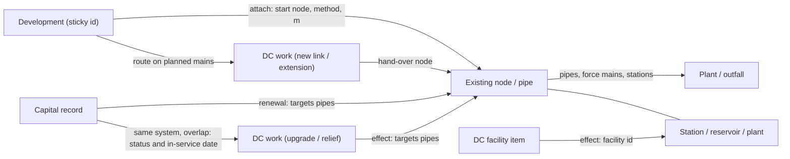

# Infrastructure dependencies: connecting projects to the existing system, and finding the developments they affect

Companion to [the architecture review](../architecture-review.md) (Part 2, links #8 and #17, and the
`infra-links.json` / `dev-links.json` files of Part 2.5) and to
[data-relationships.md](data-relationships.md). It answers two questions:

1. With reference to the capital projects, the DC projects and the existing infrastructure, what is the
   best method to determine how they all connect to the existing system?
2. What is the best method to see the development applications they affect, now and as new ones arrive?

Reviewed at `773c921` (2026-10-25). Line numbers are for that commit. Data as committed: snapshot
2026-10-19, tree-counts 2026-10-23, dc-infra 2026-10-22, capital 2026-10-19, sewers / sewers-local /
watermains 2026-10-23, servicing and blocks 2026-10-09.

How it was measured: throwaway Node scripts over `data/` that run the app's own code where it exists
(`traceDev`, `dcSewerPath`, `traceWater`, `pickRelief`, `markUpstream`, `devWorks`, `siteBrief`) and
prototype the rest. They are not in the repo (section 9). The six figures the recommendation rests on
were re-counted by separate code (section 9.1). Every figure names its numerator and denominator.
Anything not measured says so, with the reason.

Three populations are used, and each table says which:

| Name | What | Size |
|---|---|---|
| All developments | every development from `scripts/app-devs.js` with units or floor area | 20,990 (279,310 units) |
| Pipeline | of those, not completed or cancelled | 3,291 (225,424 units) |
| Pipeline with load | the pipeline developments exactly as `js/dc-impact.js:122-126` takes them (a point, and an estimate with units or jobs) | 2,745 (225,424 units) |

---

## 1. The answer in brief

**Use the network, not a radius.** Concretely:

1. **One graph of the existing system, keyed by the Region's own ids.** The nodes are manholes (`SMH…`),
   station nodes (`FACSCADA-…`), plants and the Toronto outfall for wastewater, and `WND…` nodes and
   facilities for water. The edges are pipes and mains (FacilityID), plus force mains and facility
   connectors. The raw layers carry these ids; the builds drop them today (section 6).
2. **Place each project on that graph once, at build time.** Each project gets one or more **effect**
   records: new link, extension, upgrade (upsize / twin / replacement), relief, renewal, or facility.
   Each record carries the ids of the existing pipes, mains or facilities it touches, a confidence tier
   and a reviewed flag (section 3).
3. **Attach every development to a node once a week and store its servicing path.** For wastewater:
   start pipe, ordered pipes, stations, plant. For water: zone, the main it joins, facility chain. Store
   the ids and a signature of the path (section 2).
4. **Affected = set intersection, two relations deep.** A development *connects through* a project
   when its route to the network runs on the project's planned main. It is *on the project's path* when
   the project upgrades or relieves a pipe on its downstream path, or is the station, plant or reservoir
   on its chain. Then a **time test**: does the project come into service before the development's first
   homes (section 4)? Each week, diff the result and alert (section 5).

**Why it beats the buffer methods the app uses today.** Measured over every DC project, for the
2,745 pipeline developments with load:

| Measure | 400 m buffer (today's DC rule) | Network method |
|---|---|---|
| Wastewater DC projects (97): (development, project) pairs | 621 | 8,113 (connect 344, on the path 7,823, divert 10) |
| ... buffer pairs not on the development's path | **383/621 (61.7%)** | - |
| ... network pairs the buffer finds | **238/8,113 (2.9%)** | - |
| Water DC projects (81): pairs | 617 | 7,821 (connect 76, on the route 7,781) |
| ... buffer pairs not on the supply route | **270/617 (43.8%)** | - |
| ... network pairs the buffer finds | **347/7,821 (4.4%)** | - |
| DC facilities (30): pairs | 36 within 400 m | 11,603 on the chain |
| Active capital contracts (125): pairs, site-brief 1 km radius (`js/capital-ea-model.js:747`) | 3,934; on the path 521 (13.2%) | 7,798 |
| Development page "DC works" (`js/dc-infra.js:109 devWorks`): same wastewater projects as the network | 541/2,745 developments (19.7%) | - |

What the buffer misses is growth far upstream, and what it adds is growth that is near but drains
elsewhere:

- **22-2255 Queensway East trunk** (1,800 mm, 2026-2028): the network finds 1,511 developments
  (145,123 units), median 25.2 km away; the 400 m buffer finds 10 (709 units).
- **`Brampton|295 QUEEN ST E`** (7,641 units) is 378 m from 25-2264 and is listed by the buffer and by
  `devWorks`. It joins pipe #7379 and reaches Lakeview without passing any of the 20 pipes 25-2264
  relieves.
- **28-2133** (NEW 525 mm local) is 26 m from `Brampton|2055 BOVAIRD DR W` (9,862 units), which today
  joins the existing 1,200 mm trunk #3749. It is the largest of 19 projects that have buffer developments
  but no network development (32,216 buffer units). Whether the site will use the new main is a question
  for its FSR outlet, not for a radius.
- **Beach Street SPS**: `devWorks` lists it for 1,300 developments (128,044 units) because it sits in a
  block on their block path; 18 developments (1,417 units) are on its catchment chain or pass the
  station.

The network method is also cheap: 0.10-0.11 ms per development for the wastewater path and 0.7 ms for
the water path with one cached search per facility, so all 20,990 developments take about 18 s
(section 5.1). It gives the time test a firm basis: **139 developments (35,475 units; 115 committed)
connect through a planned main that is not built before their first homes**. Example:
`Brampton|111 MAYFIELD RD` (9,961 units, first homes 2029) connects through wastewater 31-2199 (2034) and
water 31-1199 (2038).

The network here is the reference, not ground truth: the traced paths have not been checked against the
Region's hydraulic model (section 8).

---

## 2. The model

### 2.1 Entities and ids

| Entity | Id | Today | Where it lives |
|---|---|---|---|
| Wastewater node | `node:ww:SMH<n>` (manhole), `node:ww:FACSCADA-<n>` (station node) | not shipped; the build traced 57,512 manholes (`scripts/build-servicing.js`) | network extract (section 7) |
| Wastewater edge | `pipe:ww:<SMHup>-<SMHdn>` (gravity), `fm:ww:<FacilityID>` (force main) | array index; `next` / `into` are indexes (`scripts/build-sewer-capacity.js:249`, `:265`) | `sewers.json`, `sewers-local.json` |
| Water node / edge | `node:w:WND<n>`; `pipe:w:<WNDa>-<WNDb>` | rounded vertices numbered in build order (`scripts/build-watermains.js:40-52`) | `watermains.json` |
| Connector edge | `conn:<sys>:<facility>-<node>`, `bridge:ww:<a>-<b>` | none | network extract, flagged and reviewable |
| Plant / outfall | `plant:clarkson`, `plant:lakeview`, `plant:inglewood`, `outfall:toronto` | plant name; "Toronto" is also the build's fallback label (`scripts/build-sewer-capacity.js:243`) | `servicing.json`, `xwalk-plants.json` (review Part 2.5) |
| Facility | `fac:<sys>:<kind>:<slug>` with GIS FacilityID / SCADA id | `wf{i+1}` (`scripts/build-water-facilities.py:128`), `ww-<slug>` (`scripts/facilities-lib.js:39`), stations by name and point (`scripts/build-servicing.js:313`) | `xwalk-facilities.json` |
| DC work / project | `dc:<sys>:c<component>` / `dcp:2026:<project>` | component, else array position for 27 of 431 lines (`scripts/capital-lib.js:311`) | `dc-infra.json` |
| DC facility item | `dcfac:<sys>:<facility>:<item>` | none | `dc-infra.json` |
| Capital record / contract | `capr:<id>` / `cap:<contract>` | as proposed | `capital.json` |
| EA | `ea:<slug>` | as proposed | `eas.json` |
| Development | `DEV-<MUN>-<root file id>` / `SITE-<MUN>-<address point id>` (review Part 1.3) | derived keys that change with regrouping | `dev-ids.json` |

### 2.2 The effect record (a project on the network)

One row per (work, target, effect) in `infra-links.json`:

| Field | Values | Note |
|---|---|---|
| `work` | `dc:ww:c58807`, `capr:p22-2255-95b42972`, `dcfac:w:snelgrove:new-elevated-tank` | |
| `effect` | `new-link`, `extension`, `upgrade:upsize` / `upgrade:twin` / `upgrade:replacement`, `relief`, `renewal`, `facility-upgrade`, `facility-new` | section 3.3 |
| `targets` | existing edge, node or facility ids; for `new-link` / `extension`, the hand-over node ids | an upgrade lists every pipe it runs along |
| `inService` | `{ year, source: reviewed / capital-actual / capital-target / dc-year }` | section 4.3 |
| `status` | from the work's own same-system records | section 3.8 |
| `tier`, `score` | `HIGH` / `MEDIUM` / `LOW` / `REJECTED` / `UNPLACEABLE`, 0-1 | section 3.9 |
| `reasons` | `size>3x`, `parallel-runs`, `map-edge`, `cross-system-near`, `floating-group`, `renewal-before-upsize` | what the reviewer sees |
| `metrics` | `{ s10, s30, s150, sizeRatio, parRuns, endM, group, distM }` | the numbers behind the tier |
| `method` | `along30@v1`, `ends@v1`, `facname+kind@v1`, `project+system@v1` | rule and version |
| `reviewed` | `false`, or `{ by, date, decision }` from `xwalk-infra.json` | re-applied by id, else by rounded ends within 5 m |

### 2.3 The development's servicing path

One entry per development (sticky id) in `dev-links.json`:

| System | Fields |
|---|---|
| Wastewater | `start` (the node or pipe it joins), `how` (outlet / block+trunk / local→trunk / planned route / straight join / none), `m` (join distance), `conf`; `via` (planned DC lines on its route) and `handover` (the existing node the route reaches); `stations` (ordered station ids); `outfall`; `sig` (hash of the ordered edge and station ids); `planned` / `capital` (counts of route edges that are not built yet) |
| Water | `zone` and its reason, `main` (the main it joins), `m`; `chain` (ordered facility ids down to the plant or wells); `via` (planned mains on the route); `sig` |

**Store the start and the signature, not the full list.** The path follows from the start node and the
network, and a full list would be large: the median wastewater path is 211 pipes (p10 62, p90 308,
max 376; 18,209 developments with a path), and materialised it would be 3.6 million (development, pipe)
pairs. Re-walking a path takes 0.11 ms. The signature tells the weekly diff when a path changed.

An example, with today's values (ids in angle brackets are placeholders until the builds keep the
Region's ids): `Brampton|SPA-2026-0106`, a new file in the 10-19 snapshot, joins block 30 and trunk
#6247 (900 mm) at 107 m, then drains 131 pipes (22.6 km) to Lakeview. It is in zone 4. The projects on
its path are 25-2269, 22-2255 and 26-2242.

```json
"DEV-BRA-SPA-2026-0106": {
  "ww": { "start": "pipe:ww:<SMH>-<SMH>", "how": "block+trunk", "m": 107, "conf": "high",
          "via": [], "handover": null, "stations": ["<ids>"], "outfall": "plant:lakeview",
          "sig": "<hash>", "planned": 0, "capital": 0 },
  "w":  { "zone": "pz:4", "zoneWhy": "in", "main": "pipe:w:<WND>-<WND>", "m": "<m>",
          "chain": ["<facility ids>"], "via": [], "sig": "<hash>" } }
```



---

## 3. Connecting the projects to the existing system, step by step

All placement tests are **same system only**, with a direction filter of ±30° and along-shares sampled
every 10 m (DC lines) or 5 m (capital records).

### 3.1 Step 0: the existing network with ids

| Check | Today (measured) | Target |
|---|---|---|
| Ids on shipped pipes and mains | none: no id column in `sewers.json` (14,056 trunk pipes), `sewers-local.json` (42,424) or `watermains.json` (26,085 edges) | FacilityID on every edge |
| Ids available at build time | every shipped sewer had a two-manhole FacilityID: the build skips any feature without one (`scripts/build-sewer-capacity.js:89-90`), so 14,056/14,056 and 42,424/42,424. `water-supply.json` keeps `WND…-WND…` for 65/65 of its boundary mains (`scripts/build-water-supply.js:53`). Fill rate on the raw layers: not measured (not in the repo; the ArcGIS host refused requests from the review environment) | |
| Interim key while ids are missing: first and last vertex at 1e-5° | unique for 14,054/14,056 trunk pipes (one twin pair) and 42,418/42,424 local pipes | survives a reorder, not a redraw |
| Index churn after a real Region edit | not measured: the two shipped builds (10-13, 10-23) are identical row for row, because the source did not change. By the code, one retired main shifts every later index (`scripts/build-sewer-capacity.js:223-226`) | ids make this irrelevant |

### 3.2 Step 1: validate the walk

| Check | Today (measured) | Examples |
|---|---|---|
| Trunk pipes whose walk reaches a Peel plant (within 1,500 m, the build's own rule, `scripts/build-sewer-capacity.js:117`) or the Malton outlet to Toronto | 13,432 + 540 = **13,972/14,056 (99.4%)** | |
| Pipes that stop short | 82 in 6 trees | #2121 and #2647 end 2,038 m from Lakeview (89 developments end there) |
| Loop | 2 pipes | #5886 ↔ #8905, 825 mm, near Clarkson |
| False "Toronto" label | 30 of 570 Toronto-labelled pipes: 28 at dead ends or outfalls not near a plant, plus the 2 looped pipes | #6995 2,400 mm (1,565 m from Lakeview); #13357 3,000 mm (2,472 m from Clarkson) |
| `next` links that jump over pipes the file leaves out | >25 m: 99/14,023; >200 m: 49; >1 km: 9 (max about 1,560 m). 24 of the 99 start within 150 m of a pumping station: **the hidden force mains** | #234 → #11688, 1,210 m at Gore Road PS; #1860 → #12480, 953 m at Bolton PS |
| Stations the trace can see (within 80 m of a trunk, `js/sewer-trace.js:365`) | 24/39 | off: Bolton North Hill 826 m, Mayfield 820 m, Meadowvale 512 m |
| Stations on a development's path vs its PS catchment chain | same for **579/2,779 (20.8%)** of developments in a traced catchment | `Mississauga|857 & 859 LAKESHORE RD E`: chain Beach Street SPS > Beechwood, route none |
| Water: graph components | 82; the largest holds 23,577/24,922 nodes (94.6%) but only 18/44 facilities | |
| Water: lake stations off the main component | West Brampton (`wf41`) on a 42-node fragment 383 m from the main component; Tullamore (`wf40`) on a 2-node fragment; Dixie Road booster on 8 nodes | West Brampton alone gives 3,029 developments a straight supply leg |

Everything unresolved goes to a network review list (like `dc-joins.json` does for DC main ends): the 6
short trees, the loop, the 30 false labels, 15 stations off the graph and the 3 water stations. The
fix for most of them is to keep the force mains and station nodes the raw graph already walks through
(section 6).

### 3.3 Step 2: normalise projects into works, then classify each DC line

Works: 431 DC lines (234 wastewater, 197 water) in 373 component works; 35 DC facilities (32 located) with
77 items; 2,978 water and wastewater capital records with geometry. Drop component-less DC lines that lie
≥90% on another component (11 of 27 do today), and key the rest by a hash of rounded ends, not position.

| Effect | Test | Wastewater lines (km) | Water lines (km) |
|---|---|---|---|
| `upgrade` (upsize / twin / replacement): **ON-ALIGNMENT** | ≥50% of its length within 30 m of an existing same-system pipe running the same way | 66 (59.1) | 58 (151.9) |
| `relief`: **CORRIDOR-RELIEF** | ≥50% within 150 m, trunk / force / transmission main | 17 (41.4) | 0 |
| `new-link` / `extension`: **NEW** | <20% within 30 m | 143 (106.1) | 133 (179.6) |
| **PARTIAL** (split the line where it changes) | 20-50% within 30 m | 8 (15.0) | 6 (9.4) |

- **The distance matters, the share threshold does not.** Along-shares are bimodal. At 30 m, a 30% / 50% /
  70% share gives 71 / 66 / 58 wastewater lines; at a 50% share, 10 / 30 / 150 m gives 45 / 66 / 103.
- **The system gate is essential.** 72/234 wastewater DC lines run ≥50% within 30 m of a watermain;
  18 run along a watermain only (`22-2256 c34863`). 38/197 water lines run along sewers.
- **A big new main on a street with a small pipe is NEW, not an upgrade.** Size ratio >3: 8/33
  wastewater and 7/43 water ON-ALIGNMENT lines with a known size (`22-2256 c34863` 1,500 mm along a
  375 mm local; `25-2269 c52666` 2,400 mm along 250 mm).
- **Parallel runs need review.** Two candidate pipes >4 m apart on ≥25% of the line: 6/66 wastewater,
  25/58 water (`31-1199 c52652` 600 mm beside a 2,100 mm and a 400 mm main).
- **Today's relief rule picks one silently.** `pickRelief` (`js/dc-relief.js:45`, run per pipe from
  `js/masterplan.js:263`) relieves 952 trunks for 41 DC projects; 114/954 relieved trunks have two or more
  DC components that pass the rule (pipe T61 900 mm: 22-2255 c58439 / c28677 / c33590 and 22-2256
  c34863). Store every candidate with its margin.

### 3.4 Step 3: hand-overs and connectivity for NEW lines

Each end is tested with the traces' own rules (`js/sewer-trace.js:204` 25 / 600 m;
`js/water-trace.js:371` 300 / 60 m; reviewed joins first, `js/dc-joins.js:25`), and then the planned
network as a whole is tested for whether it reaches the existing one (lines joined end-to-line within
60 m).

| Measure | Wastewater | Water |
|---|---|---|
| Ends joining an existing pipe of adequate size within 25 m | 114/468 | 73/394 |
| Ends joining another DC main within 60 m | 239/468 | 275/394 |
| Open ends (+ at the DC map edge) | 22 + 3 | 4 + 3 |
| NEW lines by their ends: existing-to-existing link / extension / planned network only / isolated | 16 / 23 / 86 / 2 | 3 / 28 / 93 / 0 |
| Lines in planned groups that never reach the existing network | **45/234 (19.2%)** (`27-2192 c51654` + `27-2193 c51656` + `31-2198`) | 2/197 |

The group test is what says "connected": 59 of 104 wastewater NEW lines whose own ends meet only
planned mains or nothing still belong to a group that reaches the network.

### 3.5 Step 4: DC facilities

Match on **name core and kind and distance ≤1.5 km**; HIGH is one candidate within 300 m.

| Measure | Result |
|---|---|
| Of 35 DC facilities | existing site 18 (14 water, 4 wastewater); new site 13; co-located with another name 1; programs 3 |
| Distance from the DC map point to the matched site | ≤50 m 9/18; 50-300 m 2/18; 300-1,500 m 7/18 (A.P. Kennedy 696 m, Lorne Park 1,008 m, Inglewood 980 m) |
| Position alone fails | Jack Darling 3 sits 0 m from Jack Darling 1; a 300 m rule would miss 7/18 |
| Kind matters | the Inglewood "New Groundwater Well" matches the Inglewood plant (`wf12`) with kinds checked; the registry rule picks the reservoir (`wf37`) |
| Items | UPGRADE 50, NEW 20, REPLACE 2, other 2, program 3 (of 77); 6 NEW items at an existing site (Snelgrove New Elevated Tank 28 m from the existing tank) |
| New sites with no DC main within 150 m | 5/13; 2 set by hand in `dc-joins.json` (South Albion, Victoria), 3 remain (Hanlan West, McLaughlin, North Hill) |
| Facility items with a capital record | **0/58** facility project numbers appear in `capital.json`, whose layer is "Proposed Projects - Line" only |

### 3.6 Step 5: Region capital records

A pipe counts as worked on when ≥50% of its own length lies within 10 m of the record.

| Work class | n | In place (≤10 m) | Nothing within 30 m |
|---|---|---|---|
| Wastewater renewal (relining, trenchless, SMH) | 2,154 | **1,936 (89.9%)** | 122 |
| Wastewater new / replacement (SAN) | 212 | 161 | 12 |
| Water new / replacement (WM) | 513 | 95 | **220 (42.9%)**: `watermains.json` keeps ≥300 mm only (`scripts/build-watermains.js:22`) |

- **A pipe needs a work history, not one link.** 455/4,908 worked pipes carry two or more records; 263
  span two or more years (`T3834` 450 mm relined by 16-2300 and 20-2300).
- **Gate by system here too.** 302/555 water records lie along a sewer more than along a watermain
  (`20-1310 LONGLEAF CT WM`).
- 368 records cannot be placed until the network files carry small pipes (wastewater 143, water 225).

### 3.7 Step 6: DC works to capital records

Rule: component (HIGH); else project number **and the same system** (HIGH within 200 m or overlap ≥0.3,
else MEDIUM); else overlap ≥0.5, same system, not a renewal, capital start within the DC year ±4
(MEDIUM, HIGH with a street match). Reject cross-system, renewal and year mismatches. Add the
candidates that sit on the same existing pipe for review.

| Measure | Today's 282 links (`capital.json`) | Gated rule |
|---|---|---|
| Stale positional keys | 28/282 | keyed by component or end hash |
| Project-number links that cross systems (`scripts/capital-lib.js:349` has no system check) | **19/157** (water `c57150` → 24-1192 HEALEY RD SAN) | 0 |
| Overlap links to relining / trenchless records | 48/82 (`22-2256 c34863` → 20-2300 SAN-TRENCHLESS) | 0: kept as pipe work history and a `renewal-before-upsize` flag (14 of the 141 upgrade and relief lines, both systems) |
| Line works linked | 112/373 | 110/373 (80 HIGH); keeps 174 shipped links, adds 31 |

### 3.8 Step 7: status and in-service date

Take each DC work's status and in-service date from **its own HIGH / MEDIUM, same-system, overlapping
records** (the most advanced, with its date). Never take them from another system's record or from the
contract roll-up. Today the roll-up (`js/capital-ea-model.js:68` contracts, `:78` most advanced record on
the page, `:223 dcCapitalIndex`) makes the 22-2255 Queensway and 22-2256 Cawthra sanitary trunks read
"under construction". The only under-construction record behind them is the Queensway **watermain**
`p22-2255-5b619ea2` (start 2025-11-03). The 22-2255 sanitary records are planned (starts 2027-05-15 and
2028-02-01). The same artefact reaches four DC lines: 22-2255 c58439 ("In the 2026 budget"), c28677 and
c33590, and 22-2256 c34863 ("Paused"). Genuine conflicts on the same system, among lines shown tendered,
awarded or under construction: 3 (14-1256, 24-1176, 26-2118, overlap ≥0.9). One more is for review:
15-2153 c58566 is in the 2026 budget on the DC map, while its own sanitary records were completed in
2023 (a later phase, or a stale map). Write the result into `CAPITAL.overrides` (`js/util.js:101`) so
the chip (`js/util.js:107`) and the status text agree.

### 3.9 Step 8: tiers and score

| Effect | HIGH | MEDIUM | LOW / other |
|---|---|---|---|
| Upgrade | s10 ≥0.5 or s30 ≥0.7, one diameter class ≥50%, no parallel runs, size ratio 1-3 or named twin / relief / replacement | fits but size unknown, or parallel runs, or two classes | ratio >3 → NEW along a street; ratio <1 → LOW |
| Relief | - | named twin / relief | unnamed |
| New link / extension | both ends join and the group reaches the network | one end bridged 60-600 m or at the map edge | open, isolated or floating group |
| Renewal | in place, no parallel run | parallel run, or 10-30 m | not on the files with something within 30 m |
| Facility | one candidate ≤300 m | one candidate 300-1,500 m, or approximate point | 2+ candidates, other kind, co-located other name, NEW item at an existing site |

Score for ordering within a tier: `0.4·fit + 0.2·uniqueness + 0.2·size + 0.2·ends`. It is not calibrated:
there is no reviewed truth yet (`dc-joins.json` has 6 rows, `capital-overrides.json` 0).

Result today: DC component works HIGH 196, MEDIUM 99, LOW 78 (of 373). DC lines: wastewater 93 / 83 / 58,
water 132 / 35 / 30. Capital: wastewater HIGH 2,080/2,423, water HIGH 91/555.

### 3.10 Step 9: the review queue

- **One decision per unit of work**: per DC component (177 not HIGH), per capital contract (253 records in
  102 contracts), per facility (about 14: 7 MEDIUM, 1 co-located, 3 HIGH sites with a NEW item, 3
  unconnected new sites). Decisions go in `xwalk-infra.json` and the build re-applies them last, matched by
  id, else by rounded ends within 5 m (as `js/dc-joins.js:25`), and lists the decisions that no longer match.
- **Order by the units that rely on the work.** Measured with today's 400 m proxy: the top 25 review lines
  hold 88.8% (wastewater) and 98.9% (water) of the pipeline units near review lines. Once paths are stored,
  order by the network's units instead. The two orders differ: 28-2133 is first by the 400 m proxy
  (11,164 units) but has no development on its network (section 1). Keep such "nearby, not connected"
  mains as a second list, resolved by outlet reviews (section 6, step 7).
- Reuse the pick-and-export screen that already exists for DC main ends (`js/dc-joins.js:209 openEnd`,
  `:113 exportJSON`). Then check a sample of about 30 HIGH links and retune the thresholds.

---

## 4. Finding the affected developments

### 4.1 Attaching a development (weekly, in order)

| Order | Rule | Coverage today (measured, all 20,990) |
|---|---|---|
| 1 | Reviewed outlet (`dev-outlets.json`: point and pipe size) | 0 rows |
| 2 | In a block, nearest trunk ≤400 m (`js/svc-data.js:121-122`, `js/sewer-cap.js:87`) | 17,039 (pipeline 2,252/3,291) |
| 3 | A local sewer ≤400 m that names its trunk (not used automatically today) | 2,529 of the 3,941 without a trunk (64.2%; `Mississauga|5080` 250 mm at 172 m → trunk #9200) |
| 4 | Route along planned DC mains (`js/sewer-trace.js:285 dcSewerPath`) | 1,765 of the 2,339 outside the network; 1,160 of those routes bridge a gap |
| 5 | Straight join to a trunk 400 m-3 km: flag | 1,168 |
| 6 | None: flag | 442 |
| Water | zone by point; else the planned main's zone within 1 km (`js/dc-infra.js:97`); else nearest zone; then the facility chain (`js/water-trace.js:189`) | zone mapped 20,052, via planned main 497, nearest 434, none 7; chain to a plant 20,983 |

Paths that result, measured:

| Path | All developments | Pipeline |
|---|---|---|
| Full wastewater path on the **existing** network (site → ordered trunk pipes → plant or Toronto) | **16,937/20,990 (80.7%)**; units 205,585/279,310 (73.6%) | **2,225/3,291 (67.6%)**; units 156,929/225,424 (69.6%) |
| ... plus straight joins | 18,105 (86.3%) | 2,698 (82.0%) |
| Every water supply leg routed on existing mains | 17,580 (83.8%) | 2,994 (91.0%) |
| Water with planned and capital mains, as the app routes it (`js/water-trace.js:415`) | 20,678 (98.5%); 8,873 routes use a planned main | 3,115 (94.7%) |

The water trace counts capital mains as existing km (`js/water-trace.js:448`), so its "existing" route
is partly the future network. The stored path must mark each edge as existing, capital or planned.

**Place by the boundary when there is one.** Of 472 sites with a boundary on a trunk, the boundary's
nearest trunk differs from the point's for 150 (31.8%); the set of projects differs for 11 (2.3%), e.g.
`Mississauga|355 BURNHAMTHORPE RD W`.

### 4.2 Traversal rules by effect and system

| Effect | System | Affected developments | Shown as | Wait | Pairs today (pipeline with load) |
|---|---|---|---|---|---|
| New link / extension | wastewater | the development's stored route runs on the main | connects through | firm | 344 |
| New link / extension | water | outside the mapped zones, the main it joins is the project's (`js/dc-impact.js:146`) | connects through | firm | 76 |
| Upgrade or relief of pipes P | wastewater | its start node is upstream of any pipe in P (upstream walk, `js/dc-impact.js:55 markUpstream`) | on its path | conditional | 7,823 |
| Upgrade of mains M, or a planned main on the route | water | its supply route uses M or the main | may benefit | none by itself | 7,781 |
| Renewal of pipes R | both | upstream of R / route uses R | works on its path | none; flag `renewal-before-upsize` | 7,798 for the 125 active capital contracts, all work types |
| Station | wastewater | its path passes the station node (today: the PS catchment chain) | on its path | conditional | in the 11,603 facility pairs |
| Plant expansion | wastewater | its outfall is the plant | on its path | conditional | Clarkson WRRF: 719 developments, 69,331 units |
| Pump group, reservoir, water plant | water | its facility chain includes it | relies on | conditional | East Brampton reservoir: 545 on the chain vs 305 by zone |
| New facility site | both | the area it will serve (planned zone or catchment); today the nearest zone, approximate | relies on (approximate) | conditional | Sandhill (nearest zone 6, 1,520 m): 305 |
| NEW main with both ends on the existing network (diversion) | wastewater | upstream of the inlet end, only once the flow direction is reviewed | may be diverted | none until reviewed | 10 (indicative) |

Two cautions:

- **The water route is one shortest path through a looped network.** An upsized main near a plant sits on
  most routes (25-1220: 1,222 developments; Rangeview Rd WM: 1,315). For water, "relies on" should be the
  zone and facility chain; a main on the route is "may benefit".
- **The stricter size rule barely changes the wastewater result.** Restricting relieved pipes to 1/3 to
  2× the DC main's diameter cuts relieved trunks (with a project number) from 945 to 558, but on-path pairs
  only from 7,823 to 7,794. The big sets come from the matching big trunks on the path.

Per development: 2,621/2,745 (95.5%) are on at least one project's network, median 8 projects (p90 21).

### 4.3 The time test ("waits on")

- **Project in service**: a reviewed date; else the latest substantial completion (actual, else target,
  `js/capital-ea-model.js:61`) over its own same-system, non-renewal, HIGH / MEDIUM capital records; else
  the latest DC construction year of its lines or capacity items. Always show which source was used.
- **Development first homes**: the forecast's first year with likely homes; this year if under
  construction (`js/dc-impact.js:99`, `js/timing.js:722`).
- **Firm wait**: it connects through the project and its first homes come before the project is in
  service (`js/dc-impact.js:79 gapOf`). **Conditional wait**: it is only on the path; it waits if the
  relieved pipe, station or plant runs short, which needs the capacity test (section 8).

| Measure | Result |
|---|---|
| Firm waits | **139 developments, 35,475 units (115 committed)**. `Brampton|111 MAYFIELD RD` (9,961 units, first homes 2029): wastewater 31-2199 (2034) and water 31-1199 (2038). `Caledon|14275 THE GORE RD` (4,456 units, first homes 2027): 31-2199 (2034) and water 28-1195 (2030). 31-2199 alone: 53 developments, 18,662 units |
| Conditional only | 2,212 developments, 161,372 units (median 6 projects each): "on the path" makes 80.6% look as if they wait |
| Capital date vs DC year | 45 line projects have own same-system, non-renewal records; 27 carry a completion date; it is later than the DC year for 22 (15 by 1-2 years, 7 by 3+). Waits double: 940 → 1,977 pairs (25-2263 +4 years: 34 → 281) |
| In service the year after construction | 26-2242's on-path waits 666 → 988; 22-2255's 574 → 874 |

The DC dates are as of March 2026; Council paused new growth-related procurements from June 11, 2026
(README, "Capital schedule currency"). Show the work's status chip (`js/util.js:107`) beside every
in-service year.

### 4.4 What to show where

| Surface | Today | With the network method |
|---|---|---|
| **Development page** (servicing brief, "DC works") | `devWorks` (`js/dc-infra.js:109`): nearest main within 400 m, path-block trunks, facilities in path blocks | **Its servicing path**, e.g. `Brampton|SPA-2026-0106`: joins a 900 mm trunk at 107 m (block + trunk) → 131 pipes, 22.6 km → Lakeview (today's 80 m rule lists Torbram SPS beside the route; a station node on the graph would confirm or drop it); zone → facility chain. **Projects on its path**, one row each: effect (connects through / relieves a pipe on its path / station / plant / supply facility), in service (year, source, status), **arrives in time?** (yes; waits N years, firm; waits if short), tier and reviewed. Then "Nearby, not on its path" (the 400 m list), collapsed |
| **DC project panel, Capital › DC projects** | `js/masterplan.js:637 consDevs`, `:704 dcConnectors`, `js/dc-impact.js` tiers | **What it does to the network**: the effect records (pipes, mains or facility it upgrades, relieves or connects to; tier; reviewed). **Developments upstream**, grouped by relation, with units by first-homes year (≤2027 / 2028-30 / 2031+ / not timed) and the waits (firm, conditional). E.g. 22-2255: 1,511 developments / 145,123 units on its path, 574 / 39,514 with first homes before 2028 |
| **Pipe or facility scope** (Servicing › Network, the pipe tool result `js/sewer-cap.js:372`) | upstream loads | Developments upstream with units by year (`markUpstream`, 7.7 ms per pipe; per pipe median 19 developments, p90 628, max 7,793 at #5752), the projects on or below it (a pipe → downstream projects index), and the capital work history on that pipe |
| **Site brief** (capital, EAs) | contracts within 1 km | "On its path" first; the 1 km list as "nearby" |
| **Test a site, Inspect point** | `devWorks`; nearest DC main within 1 km (`js/tools-inspect.js:96-101`) | the same placement and lookup as the weekly build, and "would wait on" against a typed first-homes year (section 5.4) |
| **Exports, Watch** | the same rules as their pages | read `affected.json` |

---

## 5. Future applications

### 5.1 What the weekly build does with a new file

| Step | What | Cost (measured) |
|---|---|---|
| Attach | the tree build gives the file a development (sticky id); place it by its boundary, else its point, with the order in 4.1 | 0.10 ms median per development (wastewater, 2,745 pipeline: 1.35 s) |
| Trace | its wastewater path and water chain, stored with signatures | wastewater 0.11 ms (2.3 s for 20,990); water 0.7 ms with one cached search per facility (15 s for 20,990), against 12 ms per development in the app's own trace (86 s for 2,745) |
| Match | a pipe → downstream projects index (13,047/14,056 pipes have one; 51 distinct sets, 35,546 entries, at most 6 projects per pipe, built in 39 ms) plus the route's planned lines and the facility chain | one lookup per development |
| Time test and flag | waits; low-confidence placement (straight join, no path); point-only instability (5.3); changed path signature | |

Measured on the one week the repo holds (snapshot 10-12 → 10-19): 6,694 → 6,697 application files, 3 added
(Brampton SPA-2026-0101 / 0104 / 0106), all on developments with no units or floor area. Each was placed
in 0.13 ms. `SPA-2026-0101` → block 10, trunk #710 at 365 m → Clarkson, zone 5, projects 19-2208 and
25-2219. By inception date over the last 91 days, 57 pipeline developments arrived (1,368 units), about
4-5 a week; of the 410 in the last year, 399 are on a project's network and 24 wait for certain.

### 5.2 Alert rules

Diff this week's `affected.json` against the last commit (as `scripts/build-alerts.js:305
gitPrevSnapshot` already reads the last snapshot). Each alert carries both the development id and the
project id, so a watched project and a watched development both match (`js/alerts.js:29 devItems`
matches development keys only today).

| Kind | Fires when | Volume in the history held |
|---|---|---|
| `on-project-path` | a development is new on, or moved onto, a project's network (path signature or start changed) | 0 in 10-12 → 10-19 (3 files, no load); about 4-5 pipeline developments a week by inception date |
| `project-new` | a DC project appears | 10-09 → 10-22: 5 new projects; 172 pipeline developments on their network (water 30-1241: 161 developments, 24,137 units) against 17 within 400 m |
| `project-date` | a project's in-service year or status changes | capital 10-15 → 10-19: 0 status changes, 0 records added; DC 10-09 → 10-22: 0 year changes |
| `waits-on` | a development starts or stops waiting (first homes or in-service moved across the other) | not measured: one forecast version only |
| `network-changed` | an id the link files name is retired or re-pointed | not measured: the two network builds held are identical |

`scripts/build-alerts.js` is not run by any workflow today (`data/alerts.json` does not exist), and it
keys developments by the pre-tree grouping (`:82 summarizeSnapshot`). With array indexes, a rebuild that
reorders pipes would fire `on-project-path` for every development; the alerts need the stable ids first.

### 5.3 Pre-consultation and point-only sites

All 73 inception-phase pipeline developments (28,722 units) have a boundary, so a point-only site is the
Test a site or inquiry case. A point is good enough to say which projects a site relies on, not which
pipe it joins (2,278 sites on a trunk, moved in 8 directions):

| Point moved | Same start pipe | Same downstream DC projects | Same plant | Same zone |
|---|---|---|---|---|
| 50 m | 72.0% | 98.4% | 99.8% | 99.4% |
| 100 m | 52.5% | 96.8% | 99.5% | 97.9% |
| 250 m | 30.4% | 92.4% | 98.9% | 92.5% |
| 500 m | 18.1% | 86.2% | 97.6% | 86.1% |

Rule: place the point and 8 points 250 m around it. Report the projects common to all as "relies on" and
the rest as "depends on the outlet". Replace with the boundary, or a reviewed outlet, once the FSR names
one (`Mississauga|5100 ERIN MILLS PKY` moved 50 m north-east picks up 19-2208 beside 25-2219).

### 5.4 What-if: Test a site, Inspect point, a hand-placed project

Both tools should call the same placement and lookup as the weekly build, so a tapped point gets the
answer a filed application would get: 0.24 ms per point for block, nearest trunk, zone and the downstream
index (2,000 random points), plus 0.12 ms for a planned route and about 12 ms for the water trace. The
250 m stability test is 8 placements, about 2 ms. A hand-placed project (`js/sewer-profile.js:194
whatIfProject`) becomes one temporary effect record run through the same rules.

---

## 6. What the data lacks today, and the fix for each

In the order to do them. Effort: S under a week, M one to three weeks, L needs a new source or Region
input (estimates).

| # | Gap | Effect (measured) | Fix | Effort |
|---:|---|---|---|---|
| 1 | **Stable ids.** FacilityID (`SMH-SMH`), `WND` ids and station ids are read and dropped (`scripts/build-sewer-capacity.js:89`, `:249`, `:265`; `scripts/build-watermains.js:40-52`; `scripts/build-servicing.js:313`; `scripts/build-water-facilities.py:128`) | no link, path or review decision survives a rebuild; share links keep `pipe:<index>` scopes (`js/share.js:63`, `js/sewer-cap.js:372`) | write `id` and `nextId` (sewers), `intoId` (locals), an id per watermain edge, FACSCADA and layer ids per station, GIS ids per facility; `scripts/data-check.js` diffs ids and fails when a link file names a missing id | S-M |
| 2 | **Manholes, force mains and stations are not in the graph** | 99 `next` jumps >25 m (24 at stations); stations on the path match the PS chain for 20.8%; 15/39 stations invisible; 30 false Toronto labels; 6 trees stop short | ship manhole node ids as the pipes' ends; add `via: [FACSCADA-…]` on each `next` that passes a station or force main; an `outfall` field (plant / toronto / unresolved) and the network review list; build the PS catchments from the same layer as the trunks | M |
| 3 | **Component ids and the system gate** | 28/282 stale links; 19/157 cross-system; 48/82 links to renewal records; 11/27 component-less lines are overlays | key DC works by component, else a hash of rounded ends; drop overlays; `r.system === w.system` at `scripts/capital-lib.js:349`; exclude renewal work types from DC identity | S |
| 4 | **Small pipes are missing** (trunks ≥300 mm; locals only within 300 m of this week's pipeline, `scripts/build-sewer-capacity.js:55`, `:256-262`; watermains ≥300 mm) | 368 capital records unplaceable; 220/513 WM records with nothing within 30 m; 5 ON-ALIGNMENT local DC mains and 49 active capital contracts on no development's path; the local file changes when the developments change | a build-side network extract with every diameter and its ids, read by the link step; the browser files keep their size limits but carry the id column | M |
| 5 | **Facility registry and water connectors** | 7/18 matched DC facilities 300-1,500 m off; the Inglewood well matches a different record under each rule; West Brampton gives 3,029 developments a straight supply leg | `xwalk-facilities.json` (about 50 reviewed rows with GIS / SCADA id and kind); flagged connector edges from each station, reservoir and plant to its main | M |
| 6 | **Sticky development ids** (review Part 1.3) | no weekly diff of who is affected is possible | `dev-ids.json` | M |
| 7 | **Outlet reviews** | `dev-outlets.json` has 0 rows; `fsr-outlets.json` holds 66 machine-read FSRs, 54 naming an outlet (36 with a size, 42 a street, 2 a manhole number, 1 a Region project; 25 high confidence), none confirmed | review the FSR outlets into `dev-outlets.json`, queued by units, starting with the "nearby, not connected" mains (28-2133 and `Brampton|2055 BOVAIRD DR W`) and the 9 FSRs that name a proposed or future outlet | S per batch, ongoing |
| 8 | **Facility geometry and status in capital** | 0/58 facility project numbers in `capital.json`; facility status is "DC schedule only" | fetch a point or polygon capital layer (`scripts/probe-capital.js` looks for one) or the budget sheet | L |
| 9 | **The capacity test in the build** | conditional waits cannot be resolved (80.6% look as if they wait) | port the B1 test (`js/masterplan.js:280 pipeCons`, `:549 consStatus`, `:677 dcItemCons`) or store the browser's group status per relieved group; pipe-by-pipe results stay off (section 8) | M-L |
| 10 | **The network builds run by hand** (`probe-sources.yml` modes `sewer-build`, `servicing-build`) | paths cannot be tied to a network version | schedule them, record each layer's edit date and feature count, and trigger the link step | S |

---

## 7. Where it lives

### 7.1 Files

These extend the link files the review proposed (Part 2.5); they do not add a parallel set.

| File | Holds | Built by |
|---|---|---|
| network extract (all diameters, ids, `via`, connectors, `outfall`) | the graph the link step walks; size not measured (raw layers not fetched). If too large to commit, keep it as a workflow cache refreshed by the network build | `scripts/build-sewer-capacity.js`, `build-servicing.js`, `build-watermains.js`, `build-water-facilities.py` |
| `sewers.json`, `sewers-local.json`, `watermains.json`, `servicing.json` | as today, plus the id columns | same |
| `infra-links.json` | the effect records (section 2.2), DC → capital links, status and in-service per work, the network review list | new `scripts/build-infra-links.js` |
| `xwalk-infra.json`, `xwalk-facilities.json` | reviewed decisions; facility registry | by hand, exported from the review screens |
| `dev-links.json` | per development, beside the review's geography columns: the wastewater and water path entries of section 2.3 | `scripts/build-links.js` (review Part 2.5) |
| `affected.json` | per project: developments by relation (connect / path / station / plant / supply facility / may benefit), units by first-homes year, waits; per development: projects, relation, in service, wait. About 35,000 pairs for the pipeline developments (8,113 + 7,821 + 11,603 + 7,798); file size not measured | new `scripts/build-affected.js` |
| `alerts.json` | as today, plus the network kinds of 5.2 | `scripts/build-alerts.js` |

One shared module, used by Node and the browser like `js/phases.js`: `js/net-path.js` (attach, path,
signature, upstream walk, downstream index). The review's `js/link-placer.js` calls it for the trunk and
main columns, and Test a site and Inspect call it directly.

### 7.2 Build steps (`.github/workflows/site.yml`)

```
build-tree-counts (:81) -> build-links [dev-ids, dev-links with paths]
-> build-dc-gate (:90) -> build-capital (:99) -> build-eas (:107)
-> build-infra-links [effects, status, in-service]  -> build-affected  -> build-alerts
-> data-check (:135; add: every link file newer than its inputs, every id it names still exists)
```

The network builds (`probe-sources.yml` `:198-203` and `:479-481`) move to a schedule and trigger
`build-links` and `build-infra-links` in the same run.

### 7.3 Browser code it replaces

| Today (file:line) | Replaced by |
|---|---|
| `js/dc-infra.js:109 devWorks` (the "relies on" part) | `affected.json` per development; the radius stays as "nearby" |
| `js/masterplan.js:263 pipeReliefOf` → `js/dc-relief.js:45 pickRelief`, run per pipe at runtime | effect records in `infra-links.json` |
| `js/masterplan.js:637 consDevs`, `:704 dcConnectors` (and its block-only outside test, `:708`) | `affected.json` per project |
| `js/dc-impact.js:138-162` tiers A and B membership (the outside test at `:140`, B from the nearest trunk only) | `affected.json`; dc-impact keeps the capacity split and the cost shares |
| `js/sewer-trace.js:325 traceDev` per development, and the 80 m station rule (`:365`) | the stored path (the trace stays for drawing and what-ifs) |
| `js/water-trace.js:415 traceWater` per development (12-21 ms each) | the stored chain and route |
| `js/capital-ea-model.js:223 dcCapitalIndex` and the contract roll-up (`:68`, `:78`) as a status source | status per work in `infra-links.json`, into `CAPITAL.overrides` (`js/util.js:101`) |
| `js/capital-ea-model.js:747 siteBrief` (as "relies on") | "on its path" from `affected.json`; the 1 km list stays as "nearby" |
| `js/tools-inspect.js:96-101 worksSection` | `js/net-path.js` lookup |

Until the stable ids land, one quick fix is worth making on its own: dc-impact's tier A
(`js/dc-impact.js:140`) and the DC panel's connectors (`js/masterplan.js:708`) skip any site inside a
block, while the trace routes a site along the planned mains when it is in a block but has no trunk
within 400 m (`js/sewer-trace.js:334`). 174 pipeline developments (52,330 units) are in that case; only 34
(4,258 units) pass dc-impact's test. For 31-2199, dc-impact attaches 1 development against 53 on the
trace, and misses `Brampton|111 MAYFIELD RD`. Use the trace's condition in both places.

---

## 8. Limits and validation

### 8.1 How to check it

| Check | Today (measured) | What to do |
|---|---|---|
| Traced plant vs block label | 17,669/18,192 developments with a path agree (97.1%); the disagreements are block 23 (`Mississauga|7170 GOREWAY DR`: block Lakeview, route Toronto) | fix block 23's plant (review Part 2.4 #6); keep the check in `data-check.js` |
| Path stations vs PS catchment chain | 579/2,779 (20.8%) | should approach all once stations are graph nodes (section 6, #2) |
| FSR outlets | 54 of 66 machine-read FSRs name an outlet; 23 of the 36 with a size are ≥300 mm and so comparable with the trunk the trace joins; 9 name a proposed or future outlet, comparable with "connects through"; 0 confirmed. Agreement with the trace: not measured (needs the FSR → development match, which runs in the browser via `js/fsr.js`) | compare each confirmed outlet with the stored start and route; a disagreement is a review item |
| The Region's sewer and water models | not available: no model is published | ask the Region for outlet manholes and flow direction of the planned mains for the top review items |
| Reviewed sample | none yet (6 reviewed joins) | review the top 25 by units and about 30 HIGH links; report precision |
| Week-to-week stability | the two network builds held are identical, so not measured | track path-signature changes per week in the diff |

### 8.2 What it cannot tell

- **Whether a pipe on the path runs short.** Pipe-by-pipe sewer results are off (`js/util.js:55
  PIPE_RESULTS = false`): pipe capacity is left to the Region's hydraulic model (README, "Pipe class and
  'not assessed'"). So "on its path" is not "needs it". Only the connect relation gives a firm wait;
  station and plant waits can use the app's firm-capacity and plant tests; a sewer-relief wait stays
  conditional and should not be published as a pipe-level shortfall.
- **Hydraulics in the looped water network.** One shortest path per leg is a stand-in; the zone and
  facility chain are what a development relies on.
- **Flow direction of planned mains.** Not published, so diversions and which end of a NEW main is the
  outlet are assumed (65.7% of planned wastewater routes bridge a gap; 63.7% hand over outside the
  catchment the main is mapped to).
- **Which outlet a site will use before its FSR.** A point gives the right project set 92.4% of the time
  at 250 m, but the receiving pipe only 30.4% of the time.
- **Facility status.** No capital records exist for facility items (0/58).
- **Developments without load.** 2,236 pipeline developments have no units or jobs in the data; they can
  be placed but carry no flow.
- **Precision against truth.** There is no reviewed set yet; the tiers are rule-based, not calibrated.

---

## 9. How this was measured

About 30 throwaway Node scripts over `data/`, run from the repo root, written for this review and not
committed. They reproduce the app's own functions where they exist (with browser stubs) and prototype
the rest: the network walk and graph checks; each development's attachment and path; the conflation of DC
lines, DC facilities and capital records; the DC → capital link and status; the tiers and review queue;
both affected-development methods for every project; the time test; the week's new files, alert volume,
point jitter and what-if cost. The whole chain runs in about two minutes, most of it the app's water
trace (86 s for 2,745 developments).

### 9.1 The six figures the recommendation rests on, re-checked

The whole chain was re-run from scratch (development build → placement → water trace → DC-line and
capital conflation → comparison). Every output matched the first run except timings, and the DC-line and
capital row files were byte-identical. The six figures below were then re-counted by separate code.

| # | Figure | How it was re-counted | Result |
|---:|---|---|---|
| 1 | Wastewater: 383/621 (61.7%) buffer pairs not on the path; 238/8,113 (2.9%) network pairs found by the buffer | relief recomputed with the app's rule and prefilter; "on the path" by the app's upstream walk (`markUpstream`) instead of a downstream index; the 400 m distance with a separate projection | 385/622 (61.9%) and 237/8,111 (2.9%): **held**. The differences are 1 development at the 400 m edge and the 10-pair diversion heuristic, left out of the re-count. 22-2255: 1,511 / 145,123 units, buffer 10 (same) |
| 2 | Water: 270/617 (43.8%) not on the route; 347/7,821 (4.4%) found | re-counted from the stored routes with a separate 400 m distance | 270/618 (43.7%) and 348/7,821 (4.4%): **held** |
| 3 | Full path on the existing network 16,937/20,990 (80.7%); pipeline 2,225/3,291 (67.6%) | separate nearest-trunk search and walk | 16,935 (the 2 sites outside a block that the trace also accepts were excluded); pipeline 2,225/3,291 and units 156,929/225,424 exact: **held** |
| 4 | Trunk walk 13,972/14,056 reach a plant or the Malton outlet; 82 pipes in 6 trees short; 2-pipe loop; 99 jumps >25 m | separate walk over `next` | identical (49 >200 m, 9 >1 km): **held**. Corrected: 570 pipes carry the Toronto label, so 30 are false (28 dead ends plus the 2 looped pipes), not 28 |
| 5 | Firm waits: 139 developments, 35,475 units, 115 committed | re-counted from `dc-infra.json` years and the stored routes | identical: **held** |
| 6 | System gate: 19/157 project-number links cross systems; 72/234 wastewater DC lines run along a watermain | separate count from `capital.json` links and own sampling | 19/157 and 72/234: **held** |

Also confirmed: the dc-impact outside-test gap (174 developments, 52,330 units; 34 / 4,258 pass its test);
water legs on existing mains (17,580/20,990); the 22-2255 status source (section 3.8).

### 9.2 Corrections to the review

- **Part 2.4 #2** (and data-relationships.md §7, I10) says 4 "Paused" lines are under construction or
  tendered. 3 of the 4 (22-2255 c28677 and c33590, 22-2256 c34863) take "under construction" from the
  Queensway **watermain** record `p22-2255-5b619ea2` on the same contract page, through the cross-system
  roll-up; their own sanitary records are planned. The fourth, 26-2118 c58630 (tendered), is genuine. Of
  the 5 "In the 2026 budget" lines, 22-2255 c58439 has the same artefact. The fix is the one in section
  3.8 (status from the work's own same-system records), not only the chip.
- Part 2.4 #17 ("the receiving pipe, with stable pipe ids") is the wastewater half of section 4 here. The
  measured version: a full path on the existing network for 16,937/20,990 developments (80.7%), not only
  a trunk within 400 m.
